# Awesome SaaS Stack

The tools behind 6,979 live SaaS and AI products, ranked by how many of them actually use each one — not by who wrote the loudest blog post.

Every count comes from a source you can open: the maker's own words, the product's website, DNS records, subprocessor lists, customer stories and job postings (20,521 sourced usages in all). Follow a tool's link to see which products use it and why. Generated from [How Makers Build](https://howmakersbuild.com), refreshed weekly — last 2026-10-20.

<a href="https://howmakersbuild.com"><picture><source media="(prefers-color-scheme: dark)" srcset="charts/overview-dark.svg"></picture></a>

## Contents

- [Vibe coding](#vibe-coding)
  - [AI Coding Agents](#ai-coding-agents)
  - [AI Code Editors](#ai-code-editors)
  - [AI App Builders](#ai-app-builders)
  - [AI UI Design](#ai-ui-design)
  - [Parallel Agents & Spec-Driven Work](#parallel-agents--spec-driven-work)
  - [Voice Dictation](#voice-dictation)
  - [AI Code Review](#ai-code-review)
  - [AI Testing](#ai-testing)
  - [Code Editor & Terminal](#code-editor--terminal)
- [Personal agents](#personal-agents)
  - [Personal AI Agents](#personal-ai-agents)
- [AI models and media](#ai-models-and-media)
  - [LLM API](#llm-api)
  - [LLM Gateway & Routing](#llm-gateway--routing)
  - [Open Model Hosting & GPUs](#open-model-hosting--gpus)
  - [Run Models Locally](#run-models-locally)
  - [Embeddings](#embeddings)
  - [Speech-to-Text & Text-to-Speech](#speech-to-text--text-to-speech)
  - [Voice Agents](#voice-agents)
  - [Image & Video Generation](#image--video-generation)
- [Agent building blocks](#agent-building-blocks)
  - [AI SDK & Agent Framework](#ai-sdk--agent-framework)
  - [Agent Memory](#agent-memory)
  - [LLM Observability & Evals](#llm-observability--evals)
  - [Vector Database](#vector-database)
  - [Document Parsing](#document-parsing)
  - [Tool Integrations for Agents](#tool-integrations-for-agents)
  - [Code Sandboxes for Agents](#code-sandboxes-for-agents)
  - [Browser Automation for Agents](#browser-automation-for-agents)
  - [Search APIs for AI](#search-apis-for-ai)
  - [Web Scraping for AI](#web-scraping-for-ai)
- [Ship and run](#ship-and-run)
  - [Database](#database)
  - [Authentication](#authentication)
  - [Hosting](#hosting)
  - [Frontend Framework](#frontend-framework)
  - [Backend Framework](#backend-framework)
  - [Database Access & ORMs](#database-access--orms)
  - [File Storage](#file-storage)
  - [Background Jobs & Cron](#background-jobs--cron)
  - [Transactional Email](#transactional-email)
  - [Payments](#payments)
  - [Usage-Based Billing](#usage-based-billing)
  - [Error Monitoring](#error-monitoring)
  - [Image & Video Hosting](#image--video-hosting)
  - [Mobile Framework](#mobile-framework)
  - [In-App Purchases & Subscriptions](#in-app-purchases--subscriptions)
- [Grow](#grow)
  - [Web Analytics](#web-analytics)
  - [Product Analytics](#product-analytics)
  - [Newsletter](#newsletter)
  - [Lifecycle Email](#lifecycle-email)
  - [AI Search Visibility (GEO)](#ai-search-visibility-geo)
- [How the counts work](#how-the-counts-work)
- [Contributing](#contributing)

## Vibe coding

Making the product with AI — the coding agents and editors that write it, the builders that turn a prompt into an app, and what you add around them to review, test and keep several agents busy.

### AI Coding Agents

Hand a coding task to an agent that reads your repo, edits files and runs commands — in your terminal, or in a cloud machine that comes back with a pull request. What 789 makers' products chose — [decide by situation](https://howmakersbuild.com/tasks/ai-coding-assistant).

<a href="https://howmakersbuild.com/tasks/ai-coding-assistant"><picture><source media="(prefers-color-scheme: dark)" srcset="charts/ai-coding-assistant-dark.svg">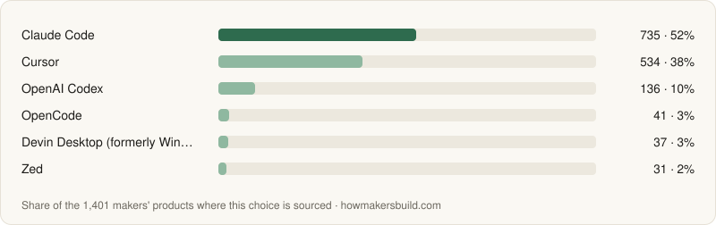</picture></a>

All 5 with what each is best for, comparisons and pricing

| Tool | Used by | Best for | More |
|---|---|---|---|
| [Claude Code](https://howmakersbuild.com/tools/claude-code) | 737 (93%) | Handing off multi-step tasks — features, refactors, bug hunts — to an agent that reads the repo, edits files and runs commands, with web sessions for running tasks in the cloud. | [vs GitHub Copilot](https://howmakersbuild.com/compare/claude-code-vs-github-copilot) · [pricing](https://howmakersbuild.com/tools/claude-code/pricing) |
| [OpenCode](https://howmakersbuild.com/tools/opencode) · open source | 42 (5%) | An open-source coding agent that works with almost any model provider, local models, or an existing Copilot or ChatGPT subscription. | [vs Claude Code](https://howmakersbuild.com/compare/claude-code-vs-opencode) · [pricing](https://howmakersbuild.com/tools/opencode/pricing) |
| [GitHub Copilot](https://howmakersbuild.com/tools/github-copilot) | 27 (3%) | Assigning a GitHub issue to Copilot's cloud agent and getting a pull request back — also from Slack, Jira or Linear — or running the Copilot CLI in a terminal, on the Copilot plan you may already have for your editor. | [vs Claude Code](https://howmakersbuild.com/compare/claude-code-vs-github-copilot) · [pricing](https://howmakersbuild.com/tools/github-copilot/pricing) |
| [Pi](https://howmakersbuild.com/tools/pi-coding-agent) · open source | 2 (<1%) | A deliberately minimal open-source (MIT) terminal agent that works with 15+ model providers through API keys or existing subscriptions, extended with packages instead of built-in features. |  |
| [Aider](https://howmakersbuild.com/tools/aider) · open source | 1 (<1%) | The original open-source terminal pair programmer, which edits files in your git repo with your own model keys or local models and commits every change. |  |

### AI Code Editors

Write code with AI completions, chat and an agent inside the editor, where you see and steer every change as it happens. What 628 makers' products chose — [decide by situation](https://howmakersbuild.com/tasks/ai-code-editor).

<a href="https://howmakersbuild.com/tasks/ai-code-editor"><picture><source media="(prefers-color-scheme: dark)" srcset="charts/ai-code-editor-dark.svg">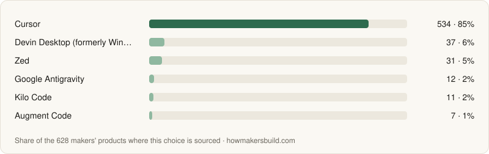</picture></a>

All 10 with what each is best for, comparisons and pricing

| Tool | Used by | Best for | More |
|---|---|---|---|
| [Cursor](https://howmakersbuild.com/tools/cursor) | 534 (85%) | A VS Code-style editor with AI completions, chat and agents built in, keeping your VS Code extensions, with cloud agents and Bugbot pull request review on the same plan. | [vs Google Antigravity](https://howmakersbuild.com/compare/antigravity-vs-cursor) · [pricing](https://howmakersbuild.com/tools/cursor/pricing) |
| [Devin Desktop (formerly Windsurf)](https://howmakersbuild.com/tools/windsurf) | 37 (6%) | A VS Code-style editor with unlimited Tab completions, an in-editor agent, and one place to manage local and cloud Devin agents. | [vs Cursor](https://howmakersbuild.com/compare/cursor-vs-windsurf) · [pricing](https://howmakersbuild.com/tools/windsurf/pricing) |
| [Zed](https://howmakersbuild.com/tools/zed) · open source | 31 (5%) | A fast, open-source native editor with built-in AI edit predictions and agent chat, and a choice of models. | [vs Cursor](https://howmakersbuild.com/compare/cursor-vs-zed) · [pricing](https://howmakersbuild.com/tools/zed/pricing) |
| [Google Antigravity](https://howmakersbuild.com/tools/antigravity) | 12 (2%) | An editor from Google with a manager view for running several coding agents in parallel, plus a CLI. | [vs Cursor](https://howmakersbuild.com/compare/antigravity-vs-cursor) |
| [Kilo Code](https://howmakersbuild.com/tools/kilo-code) · open source | 11 (2%) | An open-source agent for VS Code, JetBrains IDEs and the terminal with access to 500+ models, through your own keys, local models or Kilo's gateway at provider rates. |  |
| [Augment Code](https://howmakersbuild.com/tools/augment-code) | 7 (1%) | An agent for VS Code, JetBrains IDEs and the terminal that indexes the whole codebase, for working in large or unfamiliar repositories. |  |
| [Kiro](https://howmakersbuild.com/tools/kiro) | 6 (1%) | Spec-driven development, where the agent turns a prompt into requirements, a design and a task list before writing code, in a VS Code-compatible editor from AWS. | [vs Cursor](https://howmakersbuild.com/compare/cursor-vs-kiro) · [pricing](https://howmakersbuild.com/tools/kiro/pricing) |
| [Trae](https://howmakersbuild.com/tools/trae) | 5 (1%) | A VS Code-style editor with an agent window for parallel tasks and a SOLO mode where the agent plans and builds a feature end to end, on GPT, Gemini, Kimi, DeepSeek and other models. |  |
| [Continue](https://howmakersbuild.com/tools/continue) · open source | 4 (1%) | An open-source (Apache-2.0) agent for VS Code and JetBrains IDEs plus the `cn` CLI, with your choice of models. |  |
| [Cline](https://howmakersbuild.com/tools/cline) · open source | 3 (<1%) | An open-source agent inside VS Code, JetBrains IDEs or other VS Code-based editors that plans and makes multi-file changes, running commands with your approval, on the model provider of your choice. |  |

### AI App Builders

Describe your app in a chat and get a working, clickable version in minutes — as a prototype to test the idea, or as the start of the real codebase. What 208 makers' products chose — [decide by situation](https://howmakersbuild.com/tasks/ai-app-builder).

<a href="https://howmakersbuild.com/tasks/ai-app-builder"><picture><source media="(prefers-color-scheme: dark)" srcset="charts/ai-app-builder-dark.svg">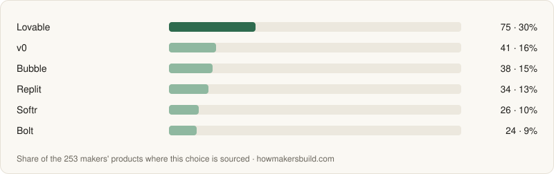</picture></a>

All 9 with what each is best for, comparisons and pricing

| Tool | Used by | Best for | More |
|---|---|---|---|
| [Lovable](https://howmakersbuild.com/tools/lovable) | 73 (35%) | Full-stack web apps from chat, with auth and database through a built-in Supabase connection. | [vs Replit](https://howmakersbuild.com/compare/lovable-vs-replit) · [pricing](https://howmakersbuild.com/tools/lovable/pricing) |
| [Bubble](https://howmakersbuild.com/tools/bubble) | 38 (18%) | Building a full web or native mobile app visually — pages, database, workflows and hosting in one place. |  |
| [Replit](https://howmakersbuild.com/tools/replit) | 34 (16%) | Building with an AI agent in a full cloud IDE, in many languages, with hosting included. | [vs Lovable](https://howmakersbuild.com/compare/lovable-vs-replit) |
| [Softr](https://howmakersbuild.com/tools/softr) | 26 (13%) | Client portals, internal tools and simple CRMs built visually on top of data you already keep in Airtable, Google Sheets, Notion or a database. |  |
| [Bolt](https://howmakersbuild.com/tools/bolt-new) | 24 (12%) | Generating and running a full-stack app entirely in the browser, with the code visible and editable as it is written. | [vs Lovable](https://howmakersbuild.com/compare/bolt-new-vs-lovable) |
| [FlutterFlow](https://howmakersbuild.com/tools/flutterflow) | 13 (6%) | Visually building mobile apps that compile to real Flutter code and deploy to the app stores. |  |
| [Base44](https://howmakersbuild.com/tools/base44) | 8 (4%) | Full-stack web apps and internal tools from chat, with database, auth and hosting built into the platform, so there is no outside backend account to set up. | [vs Replit](https://howmakersbuild.com/compare/base44-vs-replit) · [pricing](https://howmakersbuild.com/tools/base44/pricing) |
| [Rork](https://howmakersbuild.com/tools/rork) | 2 (1%) | Native mobile apps from chat — SwiftUI for iPhone, Kotlin for Android — with a hosted backend, RevenueCat subscriptions and built-in publishing to the App Store and Google Play. |  |
| [WeWeb](https://howmakersbuild.com/tools/weweb) | 1 (<1%) | Generating a web app with AI, then editing its UI, data and logic visually, on top of a backend you choose such as Supabase or Xano. |  |

### AI UI Design

Generate screens and clickable prototypes from a prompt, a sketch or your design system, to settle what the UI looks like before or while an agent builds it. What 119 makers' products chose — [decide by situation](https://howmakersbuild.com/tasks/ai-ui-design).

<a href="https://howmakersbuild.com/tasks/ai-ui-design"><picture><source media="(prefers-color-scheme: dark)" srcset="charts/ai-ui-design-dark.svg">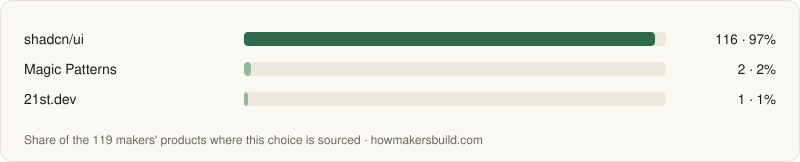</picture></a>

All 3 with what each is best for, comparisons and pricing

| Tool | Used by | Best for | More |
|---|---|---|---|
| [shadcn/ui](https://howmakersbuild.com/tools/shadcn-ui) · open source | 116 (97%) | Copy-in React components on Radix UI and Tailwind, the set v0 generates with and 21st.dev's components build on. |  |
| [Magic Patterns](https://howmakersbuild.com/tools/magic-patterns) | 2 (2%) | Interactive prototypes on a canvas generated from your design system, Figma imports or a connected GitHub repo, with an MCP server that hands designs to coding agents. |  |
| [21st.dev](https://howmakersbuild.com/tools/21st) | 1 (1%) | A marketplace of 12,000+ React and Tailwind components, templates and shadcn themes that you or your coding agent install as source through a prompt, the CLI or the 21st MCP server, plus AI UI generation. |  |

### Parallel Agents & Spec-Driven Work

Run several coding agents at once without them stepping on each other, and have them work from a written spec instead of a one-line prompt. What 31 makers' products chose — [decide by situation](https://howmakersbuild.com/tasks/agent-workflow).

<a href="https://howmakersbuild.com/tasks/agent-workflow"><picture><source media="(prefers-color-scheme: dark)" srcset="charts/agent-workflow-dark.svg">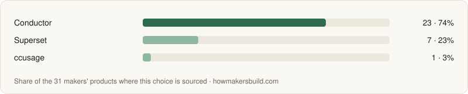</picture></a>

All 3 with what each is best for, comparisons and pricing

| Tool | Used by | Best for | More |
|---|---|---|---|
| [Conductor](https://howmakersbuild.com/tools/conductor) | 23 (74%) | Running several Claude Code, Codex, Cursor or OpenCode agents at once on a Mac, each in an isolated copy of the repo, then reviewing and merging their changes. | [vs Superset](https://howmakersbuild.com/compare/conductor-vs-superset) · [pricing](https://howmakersbuild.com/tools/conductor/pricing) |
| [Superset](https://howmakersbuild.com/tools/superset) | 7 (23%) | A desktop workspace that runs Claude Code, Codex, OpenCode and other CLI agents in parallel worktrees, with a diff viewer, automations and a mobile app, keeping code and sessions on your machine. | [vs Conductor](https://howmakersbuild.com/compare/conductor-vs-superset) |
| [ccusage](https://howmakersbuild.com/tools/ccusage) · open source | 1 (3%) | Reports of token usage and estimated cost by day, month or session, read from the local logs of Claude Code, Codex, OpenCode, Gemini CLI and other agents. |  |

### Voice Dictation

Talk to your coding agent instead of typing — dictation apps turn speech into clean text in any app, which makes long, detailed prompts quick to give. What 17 makers' products chose — [decide by situation](https://howmakersbuild.com/tasks/voice-dictation).

<a href="https://howmakersbuild.com/tasks/voice-dictation"><picture><source media="(prefers-color-scheme: dark)" srcset="charts/voice-dictation-dark.svg"></picture></a>

All 2 with what each is best for, comparisons and pricing

| Tool | Used by | Best for | More |
|---|---|---|---|
| [Wispr Flow](https://howmakersbuild.com/tools/wispr-flow) | 16 (94%) | Dictation that turns speech into edited, formatted text in any app on Mac, Windows, iPhone and Android, with an AI meeting notetaker. |  |
| [Superwhisper](https://howmakersbuild.com/tools/superwhisper) | 1 (6%) | Dictation into any app with a choice of local (offline) or cloud speech models and AI modes that rewrite the text for the context, on macOS, Windows, iOS and Android. |  |

### AI Code Review

Have an AI reviewer read every pull request to catch bugs, security issues and missed edge cases before you merge. What 33 makers' products chose — [decide by situation](https://howmakersbuild.com/tasks/ai-code-review).

<a href="https://howmakersbuild.com/tasks/ai-code-review"><picture><source media="(prefers-color-scheme: dark)" srcset="charts/ai-code-review-dark.svg">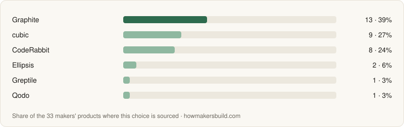</picture></a>

All 6 with what each is best for, comparisons and pricing

| Tool | Used by | Best for | More |
|---|---|---|---|
| [Graphite](https://howmakersbuild.com/tools/graphite) | 13 (39%) | AI review together with stacked pull requests, a review inbox and a merge queue, for teams that open many small PRs. |  |
| [cubic](https://howmakersbuild.com/tools/cubic) | 9 (27%) | GitHub pull request review with plain-English custom rules, plus scheduled scans of the whole codebase. |  |
| [CodeRabbit](https://howmakersbuild.com/tools/coderabbit) | 8 (24%) | Line-by-line review of every pull request on GitHub, GitLab, Bitbucket or Azure DevOps, plus reviews of local changes from the CLI or editor before you push. |  |
| [Ellipsis](https://howmakersbuild.com/tools/ellipsis) | 2 (6%) | Managed Claude Code and Codex agents defined in YAML in your repo and triggered by pull requests, schedules, Slack, Linear or Sentry, which you can set up as a custom reviewer. |  |
| [Greptile](https://howmakersbuild.com/tools/greptile) | 1 (3%) | Reviews that use an index of your whole codebase, so comments can point out how a change affects code outside the diff. |  |
| [Qodo](https://howmakersbuild.com/tools/qodo) | 1 (3%) | Pull request review with context from the whole codebase, also in the IDE and the terminal. |  |

### AI Testing

Let AI agents write, run and maintain end-to-end tests of your app, so agent-written code gets clicked through before it ships, without you writing the tests by hand. What 2 makers' products chose — [decide by situation](https://howmakersbuild.com/tasks/ai-testing).

<a href="https://howmakersbuild.com/tasks/ai-testing"><picture><source media="(prefers-color-scheme: dark)" srcset="charts/ai-testing-dark.svg"></picture></a>

All 2 with what each is best for, comparisons and pricing

| Tool | Used by | Best for | More |
|---|---|---|---|
| [Meticulous](https://howmakersbuild.com/tools/meticulous) | 1 (50%) | Frontend regression tests built from recorded sessions in your dev, staging and preview environments, replayed visually on every pull request with backend responses mocked. |  |
| [Bugster](https://howmakersbuild.com/tools/bugster) | 1 (50%) | Agents that wrote and ran end-to-end browser tests from plain-English descriptions on each pull request — now closing. |  |

### Code Editor & Terminal

Choose where you write, run and debug code every day — the editor or IDE, and the terminal beside it. What 345 makers' products chose — [decide by situation](https://howmakersbuild.com/tasks/code-editor).

<a href="https://howmakersbuild.com/tasks/code-editor"><picture><source media="(prefers-color-scheme: dark)" srcset="charts/code-editor-dark.svg">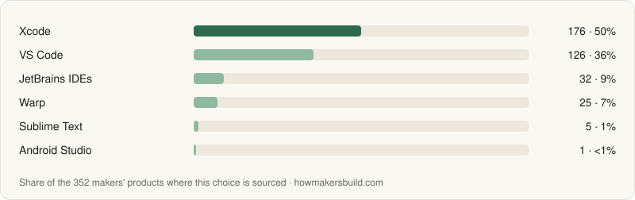</picture></a>

All 6 with what each is best for, comparisons and pricing

| Tool | Used by | Best for | More |
|---|---|---|---|
| [Xcode](https://howmakersbuild.com/tools/xcode) | 171 (50%) | Building, testing, profiling and submitting iOS and macOS apps, with simulators and Apple's frameworks built in. |  |
| [VS Code](https://howmakersbuild.com/tools/vscode) · open source | 126 (37%) | A free editor for any language, with the largest extension marketplace and built-in Git, debugging, terminal and AI agents. |  |
| [JetBrains IDEs](https://howmakersbuild.com/tools/jetbrains) | 31 (9%) | Deep code analysis, safe refactoring and debugging for one ecosystem — IntelliJ IDEA for Java and Kotlin, PyCharm for Python, WebStorm for JavaScript, GoLand, RustRover and more. |  |
| [Warp](https://howmakersbuild.com/tools/warp) · open source | 24 (7%) | An open-source terminal with command blocks, a modern input editor and built-in coding agents, on macOS, Linux and Windows. |  |
| [Sublime Text](https://howmakersbuild.com/tools/sublime-text) | 5 (1%) | A very fast, lightweight native editor with multiple cursors and a long-standing package ecosystem. |  |
| [Android Studio](https://howmakersbuild.com/tools/android-studio) | 1 (<1%) | Building, debugging and profiling Android apps, with emulators, a layout editor and Play publishing tools. |  |

## Personal agents

Always-on agents that work for you across apps and the web, and where to run them.

### Personal AI Agents

An agent that works for you rather than in your product — it reads your inbox, runs errands across your apps, does research and keeps going while you're away. What 58 makers' products chose — [decide by situation](https://howmakersbuild.com/tasks/personal-agent).

<a href="https://howmakersbuild.com/tasks/personal-agent"><picture><source media="(prefers-color-scheme: dark)" srcset="charts/personal-agent-dark.svg">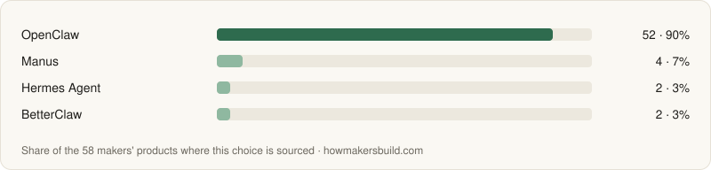</picture></a>

All 4 with what each is best for, comparisons and pricing

| Tool | Used by | Best for | More |
|---|---|---|---|
| [OpenClaw](https://howmakersbuild.com/tools/openclaw) · open source | 52 (90%) | A personal assistant you run on your own machine and talk to from WhatsApp, Telegram or another chat app, on the models you choose. |  |
| [Manus](https://howmakersbuild.com/tools/manus) | 4 (7%) | A hosted general agent that carries out multi-step tasks — research, slides, websites, media — from a web, desktop or mobile app. |  |
| [Hermes Agent](https://howmakersbuild.com/tools/hermes-agent) · open source | 2 (3%) | A self-hosted agent from Nous Research with persistent memory, skills it writes for itself, scheduled tasks and subagents, reached from chat apps, a CLI or desktop apps. |  |
| [BetterClaw](https://howmakersbuild.com/tools/betterclaw) | 2 (3%) | A hosted, no-code agent that runs jobs on a schedule in Slack, Telegram, Discord or Gmail, on your own model keys. |  |

## AI models and media

The models your product calls, how you route and serve them, and the APIs for voice, images and video.

### LLM API

Call large language models from your product. What 960 makers' products chose — [decide by situation](https://howmakersbuild.com/tasks/llm-api).

<a href="https://howmakersbuild.com/tasks/llm-api"><picture><source media="(prefers-color-scheme: dark)" srcset="charts/llm-api-dark.svg">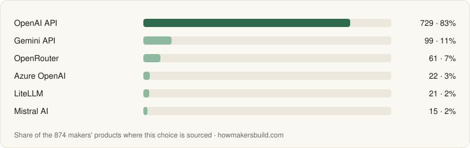</picture></a>

All 10 with what each is best for, comparisons and pricing

| Tool | Used by | Best for | More |
|---|---|---|---|
| [OpenAI API](https://howmakersbuild.com/tools/openai) | 729 (76%) | The broadest model lineup — text, images, speech, embeddings — and the largest ecosystem. | [vs Claude](https://howmakersbuild.com/compare/claude-vs-openai) · [pricing](https://howmakersbuild.com/tools/openai/pricing) |
| [Claude](https://howmakersbuild.com/tools/claude) | 252 (26%) | Coding, long documents and agent-style tool use. | [vs OpenAI API](https://howmakersbuild.com/compare/claude-vs-openai) · [pricing](https://howmakersbuild.com/tools/claude/pricing) |
| [Gemini API](https://howmakersbuild.com/tools/gemini-api) | 99 (10%) | Very long context and multimodal input, with a free tier to start. | [vs Claude](https://howmakersbuild.com/compare/claude-vs-gemini-api) · [pricing](https://howmakersbuild.com/tools/gemini-api/pricing) |
| [OpenRouter](https://howmakersbuild.com/tools/openrouter) | 61 (6%) | Trying many models from many providers with one API key and one bill, without opening an account at each. | [vs LiteLLM](https://howmakersbuild.com/compare/litellm-vs-openrouter) |
| [Azure OpenAI](https://howmakersbuild.com/tools/azure-openai) | 22 (2%) | OpenAI models inside an Azure account, with regional and EU/US data-zone deployments. | [vs OpenAI API](https://howmakersbuild.com/compare/azure-openai-vs-openai) |
| [LiteLLM](https://howmakersbuild.com/tools/litellm) · open source | 21 (2%) | Running your own OpenAI-compatible proxy in front of your own provider keys, with retries, routing and per-key budgets. | [vs OpenRouter](https://howmakersbuild.com/compare/litellm-vs-openrouter) |
| [Mistral AI](https://howmakersbuild.com/tools/mistral) | 15 (2%) | A European provider whose API covers chat, coding, OCR and speech models. | [vs Claude](https://howmakersbuild.com/compare/claude-vs-mistral) · [pricing](https://howmakersbuild.com/tools/mistral/pricing) |
| [DeepSeek](https://howmakersbuild.com/tools/deepseek) | 11 (1%) | Low per-token prices on strong reasoning and coding models, with OpenAI- and Anthropic-format endpoints. | [vs Claude](https://howmakersbuild.com/compare/claude-vs-deepseek) · [pricing](https://howmakersbuild.com/tools/deepseek/pricing) |
| [Grok API](https://howmakersbuild.com/tools/grok-api) | 6 (1%) | Grok models with built-in web and X search, plus image, video and voice APIs. | [vs Claude](https://howmakersbuild.com/compare/claude-vs-grok-api) · [pricing](https://howmakersbuild.com/tools/grok-api/pricing) |
| [MiniMax](https://howmakersbuild.com/tools/minimax) | 6 (1%) | Low per-token prices on open-weight coding and agent models, with speech, image, video and music models in the same account. | [pricing](https://howmakersbuild.com/tools/minimax/pricing) |

### LLM Gateway & Routing

Put one layer between your app and the model providers, so you can switch models, fail over and track spend without rewriting calls. What 1 makers' products chose — [decide by situation](https://howmakersbuild.com/tasks/llm-gateway).

<a href="https://howmakersbuild.com/tasks/llm-gateway"><picture><source media="(prefers-color-scheme: dark)" srcset="charts/llm-gateway-dark.svg"></picture></a>

All 1 with what each is best for, comparisons and pricing

| Tool | Used by | Best for | More |
|---|---|---|---|
| [Helicone](https://howmakersbuild.com/tools/helicone) · open source | 1 (100%) | Adding a gateway when your main goal is logging and debugging every request, with caching and rate limits on the side. | [pricing](https://howmakersbuild.com/tools/helicone/pricing) |

### Open Model Hosting & GPUs

Run open-weight or custom models in production without buying hardware — either as a ready API or on GPUs you rent. What 113 makers' products chose — [decide by situation](https://howmakersbuild.com/tasks/gpu-inference).

<a href="https://howmakersbuild.com/tasks/gpu-inference"><picture><source media="(prefers-color-scheme: dark)" srcset="charts/gpu-inference-dark.svg">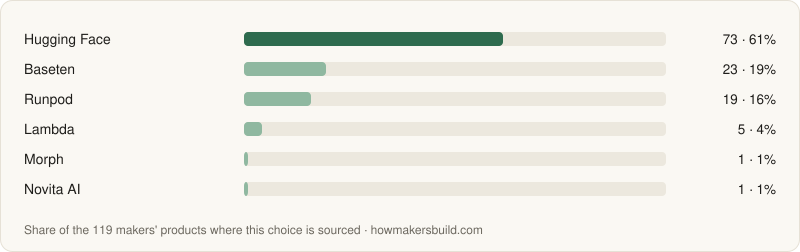</picture></a>

All 4 with what each is best for, comparisons and pricing

| Tool | Used by | Best for | More |
|---|---|---|---|
| [Hugging Face](https://howmakersbuild.com/tools/hugging-face) | 73 (65%) | Deploying almost any model from the Hugging Face Hub to a dedicated endpoint, or calling popular models through Inference Providers, which routes to partner hosts under one API. |  |
| [Baseten](https://howmakersbuild.com/tools/baseten) | 23 (20%) | Deploying a specific model as a production endpoint with autoscaling and monitoring. |  |
| [Runpod](https://howmakersbuild.com/tools/runpod) | 19 (17%) | Renting GPU machines by the hour or running serverless GPU workers, with control over the hardware. |  |
| [Morph](https://howmakersbuild.com/tools/morph) | 1 (1%) | Fast open models for coding agents (Kimi K3, GLM-5.3, Qwen, MiniMax, DeepSeek) plus its own Fast Apply, WarpGrep and Compact models, behind one OpenAI-compatible API. |  |

### Run Models Locally

Run open-weight models on your own computer for private data, offline work, free experiments or a local-first product. What 60 makers' products chose — [decide by situation](https://howmakersbuild.com/tasks/local-llm).

<a href="https://howmakersbuild.com/tasks/local-llm"><picture><source media="(prefers-color-scheme: dark)" srcset="charts/local-llm-dark.svg">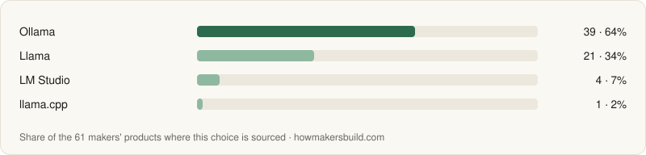</picture></a>

All 4 with what each is best for, comparisons and pricing

| Tool | Used by | Best for | More |
|---|---|---|---|
| [Ollama](https://howmakersbuild.com/tools/ollama) · open source | 38 (63%) | Pulling and running models with one command, with a local API that other tools already support. |  |
| [Llama](https://howmakersbuild.com/tools/llama) | 21 (35%) | Meta's widely supported open-weight models, available in every local runtime and in many sizes. |  |
| [LM Studio](https://howmakersbuild.com/tools/lm-studio) | 4 (7%) | Browsing, downloading and chatting with models in a GUI, then serving them through a local API. |  |
| [llama.cpp](https://howmakersbuild.com/tools/llama-cpp) · open source | 1 (2%) | Full control over builds, quantization and hardware flags, or embedding inference inside your own app. |  |

### Embeddings

Turn text (and sometimes images) into vectors so you can search, cluster and retrieve by meaning. What 18 makers' products chose — [decide by situation](https://howmakersbuild.com/tasks/embeddings).

<a href="https://howmakersbuild.com/tasks/embeddings"><picture><source media="(prefers-color-scheme: dark)" srcset="charts/embeddings-dark.svg"></picture></a>

All 1 with what each is best for, comparisons and pricing

| Tool | Used by | Best for | More |
|---|---|---|---|
| [Cohere](https://howmakersbuild.com/tools/cohere) | 18 (100%) | Multilingual search with embeddings and a reranker from the same vendor. |  |

### Speech-to-Text & Text-to-Speech

Turn audio into text, or text into natural speech, for transcription, voice features and audio content. What 232 makers' products chose — [decide by situation](https://howmakersbuild.com/tasks/speech-ai).

<a href="https://howmakersbuild.com/tasks/speech-ai"><picture><source media="(prefers-color-scheme: dark)" srcset="charts/speech-ai-dark.svg">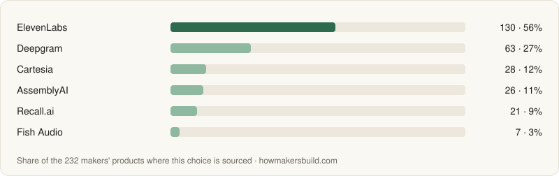</picture></a>

All 7 with what each is best for, comparisons and pricing

| Tool | Used by | Best for | More |
|---|---|---|---|
| [ElevenLabs](https://howmakersbuild.com/tools/elevenlabs) | 130 (56%) | Natural, expressive voices and voice cloning for narration, content and characters. |  |
| [Deepgram](https://howmakersbuild.com/tools/deepgram) | 63 (27%) | Streaming speech-to-text with low latency, for live calls and voice interfaces. |  |
| [Cartesia](https://howmakersbuild.com/tools/cartesia) | 28 (12%) | Text-to-speech with very low time to first audio, for live conversation. |  |
| [AssemblyAI](https://howmakersbuild.com/tools/assemblyai) | 26 (11%) | Accurate transcription of recordings with speaker labels and extras like summaries and topic detection. |  |
| [Recall.ai](https://howmakersbuild.com/tools/recall-ai) | 21 (9%) | Getting recordings, transcripts and participant data from Zoom, Google Meet, Microsoft Teams and other calls through one bot API. |  |
| [Fish Audio](https://howmakersbuild.com/tools/fish-audio) | 7 (3%) | Text-to-speech and quick voice cloning with a large library of community voices in 30+ languages. |  |
| [OpenAI API](https://howmakersbuild.com/tools/openai) | 1 (<1%) | Adding transcription and speech output on the same account you already use for text. | [pricing](https://howmakersbuild.com/tools/openai/pricing) |

### Voice Agents

Build an AI that talks with people in real time — on the phone or in the browser — by chaining speech-to-text, an LLM and text-to-speech. What 71 makers' products chose — [decide by situation](https://howmakersbuild.com/tasks/voice-agents).

<a href="https://howmakersbuild.com/tasks/voice-agents"><picture><source media="(prefers-color-scheme: dark)" srcset="charts/voice-agents-dark.svg">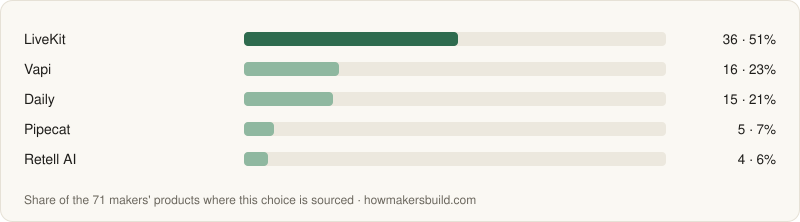</picture></a>

All 5 with what each is best for, comparisons and pricing

| Tool | Used by | Best for | More |
|---|---|---|---|
| [LiveKit](https://howmakersbuild.com/tools/livekit) · open source | 36 (51%) | Real-time voice and video in your own app, with an agents framework on top of its WebRTC infrastructure. |  |
| [Vapi](https://howmakersbuild.com/tools/vapi) | 16 (23%) | Developers who want to configure every part — models, voices, tools, phone numbers — through an API. |  |
| [Daily](https://howmakersbuild.com/tools/daily) | 15 (21%) | WebRTC audio and video transport plus Pipecat Cloud, which hosts Pipecat agents so you don't run the real-time servers. |  |
| [Pipecat](https://howmakersbuild.com/tools/pipecat) · open source | 5 (7%) | A Python pipeline where you choose and swap every speech, LLM and voice component. |  |
| [Retell AI](https://howmakersbuild.com/tools/retell-ai) | 4 (6%) | Phone agents for bookings and customer service, set up largely through a visual builder. |  |

### Image & Video Generation

Generate images or video inside your product through an API, without running GPUs yourself. What 59 makers' products chose — [decide by situation](https://howmakersbuild.com/tasks/image-generation).

<a href="https://howmakersbuild.com/tasks/image-generation"><picture><source media="(prefers-color-scheme: dark)" srcset="charts/image-generation-dark.svg">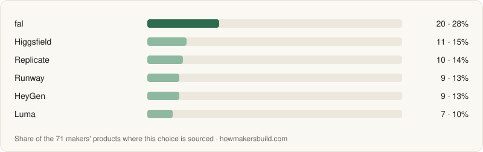</picture></a>

All 10 with what each is best for, comparisons and pricing

| Tool | Used by | Best for | More |
|---|---|---|---|
| [fal](https://howmakersbuild.com/tools/fal-ai) | 20 (34%) | Low-latency image and video generation across many current models, billed per output. |  |
| [Replicate](https://howmakersbuild.com/tools/replicate) | 10 (17%) | A wide catalog of community and open models, plus deploying your own fine-tuned model behind an API. |  |
| [Runway](https://howmakersbuild.com/tools/runwayml) | 9 (15%) | Text-to-video, image-to-video and video-to-video generation through Runway's developer API. |  |
| [Higgsfield](https://howmakersbuild.com/tools/higgsfield) | 8 (14%) | One asynchronous API (submit, then poll or receive a webhook) for Higgsfield's own image and video models, such as motion transfer. |  |
| [HeyGen](https://howmakersbuild.com/tools/heygen) | 7 (12%) | Talking-avatar videos, video translation and real-time interactive avatars rendered from your own systems through its API. |  |
| [Luma](https://howmakersbuild.com/tools/luma) | 4 (7%) | Luma's Ray video and Uni image models through an API with up to 16 keyframes per clip, video-to-video and HDR/EXR export. |  |
| [Stability AI](https://howmakersbuild.com/tools/stability-ai) | 3 (5%) | Stable Diffusion models from their maker, with open weights you can later run yourself. |  |
| [Recraft](https://howmakersbuild.com/tools/recraft) | 3 (5%) | Raster and vector (SVG) image generation with custom brand styles, icons and mockups, through its API. |  |
| [Synthesia](https://howmakersbuild.com/tools/synthesia) | 2 (3%) | Avatar presenter videos, dubbing and interactive roleplay avatars for business training, with an API for video creation and dubbing. |  |
| [ComfyUI](https://howmakersbuild.com/tools/comfyui) · open source | 1 (2%) | Building multi-step image and video pipelines — models, LoRAs, control inputs, upscalers — as node graphs you run on your own GPU or on Comfy Cloud. |  |

## Agent building blocks

What an agent inside your product is built from — a framework, memory and retrieval, tools to search, browse and run code, and a way to see what it did.

### AI SDK & Agent Framework

The code between your product and the model — streaming, tool calls, structured output — and, when you need it, the agent loop that keeps state and hands work between steps. What 117 makers' products chose — [decide by situation](https://howmakersbuild.com/tasks/agent-framework).

<a href="https://howmakersbuild.com/tasks/agent-framework"><picture><source media="(prefers-color-scheme: dark)" srcset="charts/agent-framework-dark.svg">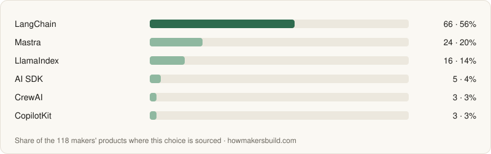</picture></a>

All 10 with what each is best for, comparisons and pricing

| Tool | Used by | Best for | More |
|---|---|---|---|
| [LangChain](https://howmakersbuild.com/tools/langchain) · open source | 65 (56%) | The largest set of ready-made integrations for models, tools and data sources, in Python and JavaScript. | [vs LlamaIndex](https://howmakersbuild.com/compare/langchain-vs-llamaindex) |
| [Mastra](https://howmakersbuild.com/tools/mastra) · open source | 24 (21%) | TypeScript and Next.js apps that want agents, workflows, memory and RAG without a Python service. | [vs AI SDK](https://howmakersbuild.com/compare/mastra-vs-vercel-ai-sdk) |
| [LlamaIndex](https://howmakersbuild.com/tools/llamaindex) · open source | 16 (14%) | Agents that mostly retrieve and reason over your own documents. | [vs LangChain](https://howmakersbuild.com/compare/langchain-vs-llamaindex) |
| [AI SDK](https://howmakersbuild.com/tools/vercel-ai-sdk) · open source | 5 (4%) | TypeScript agents with tool calling, multi-step loops and streaming to the UI, on any model provider. | [vs Mastra](https://howmakersbuild.com/compare/mastra-vs-vercel-ai-sdk) |
| [CrewAI](https://howmakersbuild.com/tools/crewai) · open source | 3 (3%) | Python projects that split work across several role-based agents, like researcher, writer and reviewer. | [vs LangChain](https://howmakersbuild.com/compare/crewai-vs-langchain) |
| [CopilotKit](https://howmakersbuild.com/tools/copilotkit) · open source | 2 (2%) | Putting an agent inside your app's UI — chat, generative UI, shared state with the page — connected to any agent backend over the AG-UI protocol. |  |
| [OpenAI Agents SDK](https://howmakersbuild.com/tools/openai-agents-sdk) · open source | 1 (1%) | A small agent loop with tools, handoffs, guardrails and tracing built in, from the OpenAI team. |  |
| [LangGraph](https://howmakersbuild.com/tools/langgraph) · open source | 1 (1%) | Stateful agents built as an explicit graph of steps, with checkpoints, retries, streaming and pauses for human approval, in Python or JavaScript. |  |
| [Dify](https://howmakersbuild.com/tools/dify-ai) | 1 (1%) | Agents, RAG chatbots and multi-step LLM workflows built on a visual canvas and published as a web app, API or MCP server. |  |
| [Langflow](https://howmakersbuild.com/tools/langflow) · open source | 1 (1%) | Agents, RAG flows and MCP servers assembled from components on a visual canvas and served as an API, an MCP server or an embedded chat widget, under the MIT license. |  |

### Agent Memory

Let your agent remember users, past conversations and what it learned, across sessions, without stuffing every old message back into the prompt. What 5 makers' products chose — [decide by situation](https://howmakersbuild.com/tasks/agent-memory).

<a href="https://howmakersbuild.com/tasks/agent-memory"><picture><source media="(prefers-color-scheme: dark)" srcset="charts/agent-memory-dark.svg">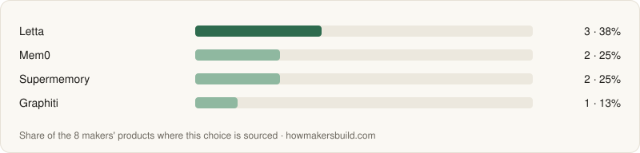</picture></a>

All 3 with what each is best for, comparisons and pricing

| Tool | Used by | Best for | More |
|---|---|---|---|
| [Mem0](https://howmakersbuild.com/tools/mem0) · open source | 2 (40%) | A drop-in memory layer that extracts facts from conversations and retrieves them later, as a hosted API or an Apache-licensed library. |  |
| [Supermemory](https://howmakersbuild.com/tools/supermemory) · open source | 2 (40%) | A memory API that learns from users' chats, files and URLs and injects what it knows into the model's context, also available as plugins and an MCP server. |  |
| [Graphiti](https://howmakersbuild.com/tools/graphiti) · open source | 1 (20%) | A Python library for temporal knowledge graphs that agents update in real time, on Neo4j, FalkorDB, Kuzu or Neptune. |  |

### LLM Observability & Evals

See what your prompts, models and agents actually did in production, and test changes against real examples before you ship them. What 65 makers' products chose — [decide by situation](https://howmakersbuild.com/tasks/llm-observability).

<a href="https://howmakersbuild.com/tasks/llm-observability"><picture><source media="(prefers-color-scheme: dark)" srcset="charts/llm-observability-dark.svg"></picture></a>

All 5 with what each is best for, comparisons and pricing

| Tool | Used by | Best for | More |
|---|---|---|---|
| [Langfuse](https://howmakersbuild.com/tools/langfuse) · open source | 34 (52%) | Tracing, prompt management and evals in one tool you can run on your own server for free. | [vs LangSmith](https://howmakersbuild.com/compare/langfuse-vs-langsmith) · [pricing](https://howmakersbuild.com/tools/langfuse/pricing) |
| [Helicone](https://howmakersbuild.com/tools/helicone) · open source | 13 (20%) | Getting request logs, costs and latency by changing one base URL, with no SDK instrumentation. | [vs Langfuse](https://howmakersbuild.com/compare/helicone-vs-langfuse) · [pricing](https://howmakersbuild.com/tools/helicone/pricing) |
| [LangSmith](https://howmakersbuild.com/tools/langsmith) | 11 (17%) | Apps built on LangChain or LangGraph, where tracing works with almost no setup. | [vs Langfuse](https://howmakersbuild.com/compare/langfuse-vs-langsmith) · [pricing](https://howmakersbuild.com/tools/langsmith/pricing) |
| [Braintrust](https://howmakersbuild.com/tools/braintrust) | 6 (9%) | Eval-driven work — scoring outputs and comparing prompts and models side by side in experiments. | [vs LangSmith](https://howmakersbuild.com/compare/braintrust-vs-langsmith) |
| [Weights & Biases](https://howmakersbuild.com/tools/weights-biases) | 1 (2%) | Tracing and evaluating LLM apps and agents with W&B Weave, in the same account you use for experiment tracking and a model registry when you train or fine-tune models. |  |

### Vector Database

Store embeddings and find the most similar ones fast, for semantic search, RAG and recommendations. What 107 makers' products chose — [decide by situation](https://howmakersbuild.com/tasks/vector-database).

<a href="https://howmakersbuild.com/tasks/vector-database"><picture><source media="(prefers-color-scheme: dark)" srcset="charts/vector-database-dark.svg">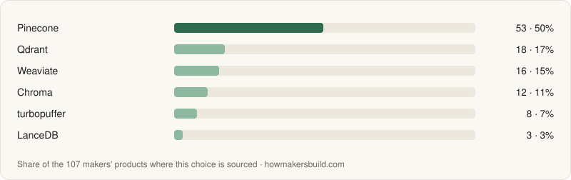</picture></a>

All 7 with what each is best for, comparisons and pricing

| Tool | Used by | Best for | More |
|---|---|---|---|
| [Pinecone](https://howmakersbuild.com/tools/pinecone) | 53 (50%) | A fully hosted index with nothing to operate, sized by usage. | [vs Weaviate](https://howmakersbuild.com/compare/pinecone-vs-weaviate) · [pricing](https://howmakersbuild.com/tools/pinecone/pricing) |
| [Qdrant](https://howmakersbuild.com/tools/qdrant) · open source | 18 (17%) | Heavy metadata filtering alongside vector search, self-hosted from one binary or on its managed cloud. | [vs Chroma](https://howmakersbuild.com/compare/chroma-vs-qdrant) · [pricing](https://howmakersbuild.com/tools/qdrant/pricing) |
| [Weaviate](https://howmakersbuild.com/tools/weaviate) · open source | 16 (15%) | Hybrid search that mixes keyword and vector results, with built-in modules that can create embeddings for you. | [vs Pinecone](https://howmakersbuild.com/compare/pinecone-vs-weaviate) · [pricing](https://howmakersbuild.com/tools/weaviate/pricing) |
| [Chroma](https://howmakersbuild.com/tools/chroma) · open source | 12 (11%) | Prototyping RAG on your laptop with a pip or npm install and no server to run. | [vs Qdrant](https://howmakersbuild.com/compare/chroma-vs-qdrant) · [pricing](https://howmakersbuild.com/tools/chroma/pricing) |
| [turbopuffer](https://howmakersbuild.com/tools/turbopuffer) | 8 (7%) | Very large or many-tenant indexes where storing everything on object storage keeps cost down. | [vs LanceDB](https://howmakersbuild.com/compare/lancedb-vs-turbopuffer) · [pricing](https://howmakersbuild.com/tools/turbopuffer/pricing) |
| [LanceDB](https://howmakersbuild.com/tools/lancedb) · open source | 3 (3%) | An embedded vector database that stores vectors and data as files on local disk or object storage, with no server to run. | [vs Qdrant](https://howmakersbuild.com/compare/lancedb-vs-qdrant) |
| [pgvector](https://howmakersbuild.com/tools/pgvector) · open source | 1 (1%) | Apps already on Postgres that want vector search in the same database, joined with normal tables. |  |

### Document Parsing

Turn PDFs, scans, slides and spreadsheets into clean text and tables a model can use, before chunking and embedding them. What 12 makers' products chose — [decide by situation](https://howmakersbuild.com/tasks/document-parsing).

<a href="https://howmakersbuild.com/tasks/document-parsing"><picture><source media="(prefers-color-scheme: dark)" srcset="charts/document-parsing-dark.svg">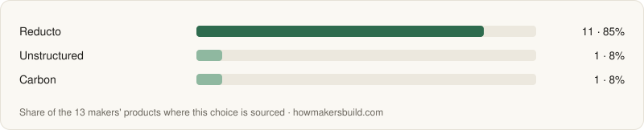</picture></a>

All 2 with what each is best for, comparisons and pricing

| Tool | Used by | Best for | More |
|---|---|---|---|
| [Reducto](https://howmakersbuild.com/tools/reducto) | 11 (92%) | Hard documents — scanned forms, dense tables, financial and legal files — where extraction accuracy matters most. |  |
| [Unstructured](https://howmakersbuild.com/tools/unstructured) · open source | 1 (8%) | Many file types through one pipeline, starting with the open-source library and moving to the hosted API later. |  |

### Tool Integrations for Agents

Let your agent act in the apps your users already use — Gmail, Slack, GitHub, CRMs — without building each OAuth flow and API client yourself. What 34 makers' products chose — [decide by situation](https://howmakersbuild.com/tasks/agent-tools).

<a href="https://howmakersbuild.com/tasks/agent-tools"><picture><source media="(prefers-color-scheme: dark)" srcset="charts/agent-tools-dark.svg">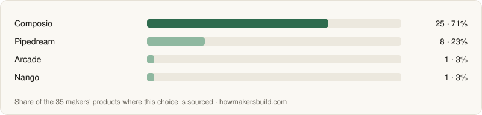</picture></a>

All 3 with what each is best for, comparisons and pricing

| Tool | Used by | Best for | More |
|---|---|---|---|
| [Composio](https://howmakersbuild.com/tools/composio) · open source | 25 (74%) | Connecting an agent to many apps at once, with tool schemas and per-user OAuth ready for the model. |  |
| [Pipedream](https://howmakersbuild.com/tools/pipedream) | 8 (24%) | Managed auth and prebuilt actions across thousands of APIs, plus event triggers and workflows beyond agent use. |  |
| [Arcade](https://howmakersbuild.com/tools/arcade-dev) | 1 (3%) | Agents that act on behalf of each signed-in user, with per-user authorization and prebuilt tools, plus a framework for writing your own tools as MCP servers. |  |

### Code Sandboxes for Agents

Give your agent an isolated computer to run the code and shell commands it writes, away from your servers and your secrets. What 24 makers' products chose — [decide by situation](https://howmakersbuild.com/tasks/code-sandbox).

<a href="https://howmakersbuild.com/tasks/code-sandbox"><picture><source media="(prefers-color-scheme: dark)" srcset="charts/code-sandbox-dark.svg"></picture></a>

All 2 with what each is best for, comparisons and pricing

| Tool | Used by | Best for | More |
|---|---|---|---|
| [Daytona](https://howmakersbuild.com/tools/daytona) | 22 (92%) | Giving an agent its own isolated computer to run generated code, edit files and use a shell, created and torn down via SDK. |  |
| [Blaxel](https://howmakersbuild.com/tools/blaxel) | 2 (8%) | Sandboxes that suspend when the agent is idle and resume in about 25 ms, next to hosting for the agent itself. |  |

### Browser Automation for Agents

Let an AI agent use websites like a person — navigate, click, fill forms and read pages — when there is no API. What 28 makers' products chose — [decide by situation](https://howmakersbuild.com/tasks/browser-agents).

<a href="https://howmakersbuild.com/tasks/browser-agents"><picture><source media="(prefers-color-scheme: dark)" srcset="charts/browser-agents-dark.svg">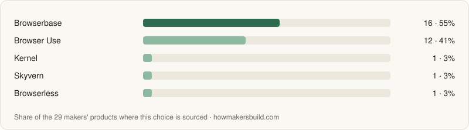</picture></a>

All 3 with what each is best for, comparisons and pricing

| Tool | Used by | Best for | More |
|---|---|---|---|
| [Browserbase](https://howmakersbuild.com/tools/browserbase) | 16 (57%) | Running many headless browsers in the cloud with session recordings, proxies and captcha handling. |  |
| [Browser Use](https://howmakersbuild.com/tools/browser-use) · open source | 12 (43%) | Giving a model a browser and a goal in a few lines of Python, and letting it work out the clicks. |  |
| [Kernel](https://howmakersbuild.com/tools/kernel) | 1 (4%) | Cloud browsers for agents with reusable sessions and handling for bot checks; the browser images are open source. |  |

### Search APIs for AI

Give your model or agent live web search, so answers use current information instead of only training data. What 80 makers' products chose — [decide by situation](https://howmakersbuild.com/tasks/ai-search-api).

<a href="https://howmakersbuild.com/tasks/ai-search-api"><picture><source media="(prefers-color-scheme: dark)" srcset="charts/ai-search-api-dark.svg">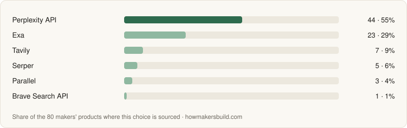</picture></a>

All 6 with what each is best for, comparisons and pricing

| Tool | Used by | Best for | More |
|---|---|---|---|
| [Perplexity API](https://howmakersbuild.com/tools/perplexity) | 44 (55%) | Getting a finished answer with citations from one call, without building a search-and-summarize pipeline. |  |
| [Exa](https://howmakersbuild.com/tools/exa) | 23 (29%) | Finding pages by meaning rather than keywords, such as "companies like this one" or "papers similar to this". |  |
| [Tavily](https://howmakersbuild.com/tools/tavily) | 7 (9%) | Agent tools that need search plus page extraction in one call, with the content already cleaned. |  |
| [Serper](https://howmakersbuild.com/tools/serper) | 5 (6%) | Structured Google results — web, news, images, maps, shopping — at a low price per query. |  |
| [Parallel](https://howmakersbuild.com/tools/parallel) | 3 (4%) | Search, page extraction and multi-step research tasks through one API, plus monitors that watch for changes. |  |
| [Brave Search API](https://howmakersbuild.com/tools/brave-search-api) | 1 (1%) | Web search results from Brave's own index, with an answers endpoint and a free monthly credit. |  |

### Web Scraping for AI

Turn web pages into clean Markdown or structured data that a model can read, for RAG, research agents or data features. What 54 makers' products chose — [decide by situation](https://howmakersbuild.com/tasks/web-data-for-ai).

<a href="https://howmakersbuild.com/tasks/web-data-for-ai"><picture><source media="(prefers-color-scheme: dark)" srcset="charts/web-data-for-ai-dark.svg">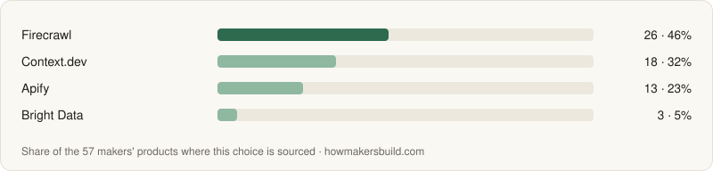</picture></a>

All 3 with what each is best for, comparisons and pricing

| Tool | Used by | Best for | More |
|---|---|---|---|
| [Firecrawl](https://howmakersbuild.com/tools/firecrawl) · open source | 26 (48%) | Crawling whole sites into Markdown or JSON through one API that handles rendering and blocking. |  |
| [Context.dev](https://howmakersbuild.com/tools/context-dev) | 18 (33%) | Scraping and crawling pages into Markdown plus company brand data — logos, colors, fonts — from one credit-based API. |  |
| [Apify](https://howmakersbuild.com/tools/apify) | 13 (24%) | Ready-made scrapers for specific sites — maps listings, social profiles, e-commerce — that you run without writing one. |  |

## Ship and run

What the product you ship runs on — the same parts as any web or mobile product, picked by makers who build with AI, including billing by usage.

### Database

Store your app's data somewhere reliable, and talk to it from code. What 1,243 makers' products chose — [decide by situation](https://howmakersbuild.com/tasks/database).

<a href="https://howmakersbuild.com/tasks/database"><picture><source media="(prefers-color-scheme: dark)" srcset="charts/database-dark.svg">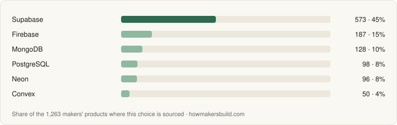</picture></a>

All 10 with what each is best for, comparisons and pricing

| Tool | Used by | Best for | More |
|---|---|---|---|
| [Supabase](https://howmakersbuild.com/tools/supabase) · open source | 560 (45%) | Postgres plus auth, storage and realtime in one project. | [vs Firebase](https://howmakersbuild.com/compare/firebase-vs-supabase) · [pricing](https://howmakersbuild.com/tools/supabase/pricing) |
| [Firebase](https://howmakersbuild.com/tools/firebase) | 183 (15%) | Mobile apps that need offline sync and client-side SDKs. | [vs Supabase](https://howmakersbuild.com/compare/firebase-vs-supabase) · [pricing](https://howmakersbuild.com/tools/firebase/pricing) |
| [MongoDB](https://howmakersbuild.com/tools/mongodb) | 127 (10%) | Document-shaped data and teams already fluent in Mongo. | [vs PostgreSQL](https://howmakersbuild.com/compare/mongodb-vs-postgresql) · [pricing](https://howmakersbuild.com/tools/mongodb/pricing) |
| [PostgreSQL](https://howmakersbuild.com/tools/postgresql) · open source | 98 (8%) | The engine behind most of the hosted options above, run on your own server or container for full control and a flat cost. | [vs MongoDB](https://howmakersbuild.com/compare/mongodb-vs-postgresql) |
| [Neon](https://howmakersbuild.com/tools/neon) · open source | 95 (8%) | Serverless Postgres that scales to zero, with a branch per preview deploy. | [vs Supabase](https://howmakersbuild.com/compare/neon-vs-supabase) · [pricing](https://howmakersbuild.com/tools/neon/pricing) |
| [Convex](https://howmakersbuild.com/tools/convex) · open source | 50 (4%) | Realtime, collaborative apps written entirely in TypeScript. | [vs Supabase](https://howmakersbuild.com/compare/convex-vs-supabase) · [pricing](https://howmakersbuild.com/tools/convex/pricing) |
| [ClickHouse](https://howmakersbuild.com/tools/clickhouse) · open source | 47 (4%) | Fast aggregate queries over billions of rows of events, logs or metrics, self-hosted or on ClickHouse Cloud. | [vs DuckDB](https://howmakersbuild.com/compare/clickhouse-vs-duckdb) |
| [PlanetScale](https://howmakersbuild.com/tools/planetscale) | 29 (2%) | Apps that expect heavy scale and want zero-downtime schema changes. | [vs Neon](https://howmakersbuild.com/compare/neon-vs-planetscale) · [pricing](https://howmakersbuild.com/tools/planetscale/pricing) |
| [Tinybird](https://howmakersbuild.com/tools/tinybird) | 29 (2%) | Managed ClickHouse that turns SQL over event streams into fast API endpoints for dashboards and usage analytics in your product. | [vs ClickHouse](https://howmakersbuild.com/compare/clickhouse-vs-tinybird) · [pricing](https://howmakersbuild.com/tools/tinybird/pricing) |
| [Snowflake](https://howmakersbuild.com/tools/snowflake) | 24 (2%) | A managed data warehouse that joins data from your app, billing and other sources, on the AWS, Azure or Google Cloud region you choose. |  |

### Authentication

Let users sign up, sign in and stay signed in — without building password storage, sessions and OAuth yourself. What 420 makers' products chose — [decide by situation](https://howmakersbuild.com/tasks/authentication).

<a href="https://howmakersbuild.com/tasks/authentication"><picture><source media="(prefers-color-scheme: dark)" srcset="charts/authentication-dark.svg">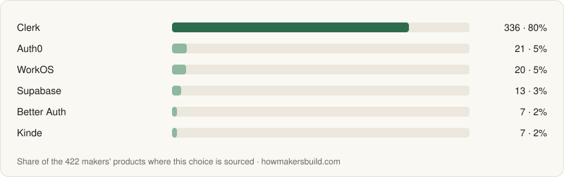</picture></a>

All 10 with what each is best for, comparisons and pricing

| Tool | Used by | Best for | More |
|---|---|---|---|
| [Clerk](https://howmakersbuild.com/tools/clerk) | 334 (80%) | Dropping prebuilt sign-in, profile and organization UI into a React or Next.js app. | [vs Auth0](https://howmakersbuild.com/compare/auth0-vs-clerk) · [pricing](https://howmakersbuild.com/tools/clerk/pricing) |
| [Auth0](https://howmakersbuild.com/tools/auth0) | 21 (5%) | Complex identity needs and enterprise compliance. | [vs WorkOS](https://howmakersbuild.com/compare/auth0-vs-workos) · [pricing](https://howmakersbuild.com/tools/auth0/pricing) |
| [WorkOS](https://howmakersbuild.com/tools/workos) | 20 (5%) | B2B SaaS that will need enterprise SSO and directory sync. | [vs Auth0](https://howmakersbuild.com/compare/auth0-vs-workos) · [pricing](https://howmakersbuild.com/tools/workos/pricing) |
| [Supabase](https://howmakersbuild.com/tools/supabase) · open source | 13 (3%) | Apps already on Supabase — auth is part of the same project as the database. | [vs Clerk](https://howmakersbuild.com/compare/clerk-vs-supabase) · [pricing](https://howmakersbuild.com/tools/supabase/pricing) |
| [Better Auth](https://howmakersbuild.com/tools/better-auth) · open source | 7 (2%) | TypeScript apps that want users and sessions in their own database, at no cost. | [vs Auth.js](https://howmakersbuild.com/compare/authjs-vs-better-auth) · [pricing](https://howmakersbuild.com/tools/better-auth/pricing) |
| [Kinde](https://howmakersbuild.com/tools/kinde) | 7 (2%) | Auth that also covers feature flags and organizations in one place. | [pricing](https://howmakersbuild.com/tools/kinde/pricing) |
| [PropelAuth](https://howmakersbuild.com/tools/propelauth) | 5 (1%) | B2B products where every customer is an organization with members, roles, invites and SAML. | [pricing](https://howmakersbuild.com/tools/propelauth/pricing) |
| [Stytch](https://howmakersbuild.com/tools/stytch) | 5 (1%) | Passwordless sign-in (magic links, one-time codes, passkeys) and B2B SSO through APIs, free up to 10,000 monthly active users. |  |
| [Firebase](https://howmakersbuild.com/tools/firebase) | 4 (1%) | Mobile and client-heavy apps already using Firebase. | [pricing](https://howmakersbuild.com/tools/firebase/pricing) |
| [Hexclave (Stack Auth)](https://howmakersbuild.com/tools/stack-auth) · open source | 2 (<1%) | A Clerk-style developer experience you can also self-host. | [pricing](https://howmakersbuild.com/tools/stack-auth/pricing) |

### Hosting

Get your app onto the internet with a URL, HTTPS and deploys from git. What 3,504 makers' products chose — [decide by situation](https://howmakersbuild.com/tasks/hosting).

<a href="https://howmakersbuild.com/tasks/hosting"><picture><source media="(prefers-color-scheme: dark)" srcset="charts/hosting-dark.svg">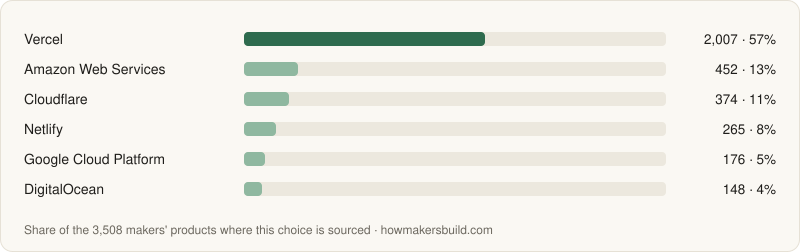</picture></a>

All 10 with what each is best for, comparisons and pricing

| Tool | Used by | Best for | More |
|---|---|---|---|
| [Vercel](https://howmakersbuild.com/tools/vercel) | 2,007 (57%) | Next.js apps — zero-config deploys and preview URLs. | [vs Netlify](https://howmakersbuild.com/compare/netlify-vs-vercel) · [pricing](https://howmakersbuild.com/tools/vercel/pricing) |
| [Amazon Web Services](https://howmakersbuild.com/tools/aws) | 450 (13%) | The widest catalog of building blocks — Lambda, containers, managed databases, queues — to assemble your own infrastructure. | [vs Microsoft Azure](https://howmakersbuild.com/compare/aws-vs-microsoft-azure) · [pricing](https://howmakersbuild.com/tools/aws/pricing) |
| [Cloudflare](https://howmakersbuild.com/tools/cloudflare) | 374 (11%) | Cheap global hosting with Workers, plus database (D1) and storage (R2) on the same platform. | [vs Vercel](https://howmakersbuild.com/compare/cloudflare-vs-vercel) · [pricing](https://howmakersbuild.com/tools/cloudflare/pricing) |
| [Netlify](https://howmakersbuild.com/tools/netlify) | 265 (8%) | Static sites and JAMstack apps on any framework. | [vs Vercel](https://howmakersbuild.com/compare/netlify-vs-vercel) · [pricing](https://howmakersbuild.com/tools/netlify/pricing) |
| [Google Cloud Platform](https://howmakersbuild.com/tools/google-cloud) | 176 (5%) | Containers on Cloud Run that scale to zero, next to BigQuery, Firebase and Google's AI services. | [vs Amazon Web Services](https://howmakersbuild.com/compare/aws-vs-google-cloud) |
| [DigitalOcean](https://howmakersbuild.com/tools/digitalocean) | 148 (4%) | App Platform deploys from git next to DigitalOcean's managed databases, storage and droplets. | [vs Amazon Web Services](https://howmakersbuild.com/compare/aws-vs-digitalocean) |
| [Render](https://howmakersbuild.com/tools/render) | 137 (4%) | A Heroku-style platform for web services, cron jobs and Postgres. | [vs Railway](https://howmakersbuild.com/compare/railway-vs-render) · [pricing](https://howmakersbuild.com/tools/render/pricing) |
| [GitHub Pages](https://howmakersbuild.com/tools/github-pages) | 128 (4%) | Free hosting for static sites, docs and landing pages published straight from a repo. | [vs Netlify](https://howmakersbuild.com/compare/github-pages-vs-netlify) |
| [Railway](https://howmakersbuild.com/tools/railway) | 120 (3%) | Servers, workers and databases deployed together, with almost no configuration. | [vs Render](https://howmakersbuild.com/compare/railway-vs-render) · [pricing](https://howmakersbuild.com/tools/railway/pricing) |
| [Hetzner Cloud](https://howmakersbuild.com/tools/hetzner) | 110 (3%) | A lot of CPU and RAM per euro, in European, US and Singapore regions. | [vs DigitalOcean](https://howmakersbuild.com/compare/digitalocean-vs-hetzner) · [pricing](https://howmakersbuild.com/tools/hetzner/pricing) |

### Frontend Framework

Pick the full-stack framework your web app lives in — routing, data loading, server code and rendering — on top of a UI library. What 2,280 makers' products chose — [decide by situation](https://howmakersbuild.com/tasks/frontend-framework).

<a href="https://howmakersbuild.com/tasks/frontend-framework"><picture><source media="(prefers-color-scheme: dark)" srcset="charts/frontend-framework-dark.svg">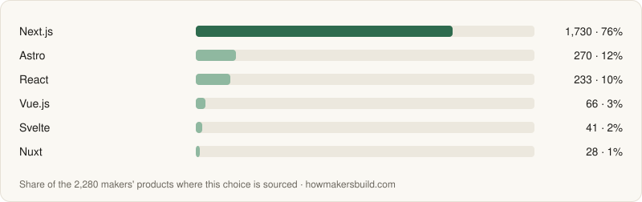</picture></a>

All 10 with what each is best for, comparisons and pricing

| Tool | Used by | Best for | More |
|---|---|---|---|
| [Next.js](https://howmakersbuild.com/tools/nextjs) · open source | 1,730 (76%) | React apps that want server rendering, API routes and the largest set of examples, templates and SaaS starters. | [vs Astro](https://howmakersbuild.com/compare/astro-vs-nextjs) |
| [Astro](https://howmakersbuild.com/tools/astro) · open source | 270 (12%) | Marketing sites, docs and blogs that ship minimal JavaScript, with interactive islands from any UI library. | [vs Next.js](https://howmakersbuild.com/compare/astro-vs-nextjs) |
| [React](https://howmakersbuild.com/tools/react) · open source | 233 (10%) | Single-page apps built from React components, with the largest ecosystem of component libraries, examples and AI-generated code. | [vs Angular](https://howmakersbuild.com/compare/angular-vs-react) |
| [Vue.js](https://howmakersbuild.com/tools/vue) · open source | 66 (3%) | Single-page apps with approachable single-file components and official router and state libraries from the same team. | [vs React](https://howmakersbuild.com/compare/react-vs-vue) |
| [Svelte](https://howmakersbuild.com/tools/svelte) · open source | 41 (2%) | Interactive apps and widgets with little boilerplate, compiled to small client bundles. | [vs SolidJS](https://howmakersbuild.com/compare/solid-vs-svelte) |
| [Nuxt](https://howmakersbuild.com/tools/nuxt) · open source | 28 (1%) | Vue apps, with a large module ecosystem for auth, content, images and SEO. | [vs Next.js](https://howmakersbuild.com/compare/nextjs-vs-nuxt) |
| [Angular](https://howmakersbuild.com/tools/angular) · open source | 23 (1%) | Larger TypeScript apps that want routing, forms, an HTTP client, dependency injection and a CLI from one framework, with signals for reactivity. | [vs React](https://howmakersbuild.com/compare/angular-vs-react) |
| [SolidJS](https://howmakersbuild.com/tools/solid) · open source | 5 (<1%) | Fast, small interactive apps written in JSX, where signals update only the parts of the page that change. | [vs Svelte](https://howmakersbuild.com/compare/solid-vs-svelte) |
| [htmx](https://howmakersbuild.com/tools/htmx) · open source | 3 (<1%) | Server-rendered apps where links, forms and buttons fetch HTML fragments from the backend and swap them into the page, with no client-side framework. |  |
| [SvelteKit](https://howmakersbuild.com/tools/sveltekit) · open source | 2 (<1%) | Apps written in Svelte, with less boilerplate and small client bundles. |  |

### Backend Framework

Pick the framework that serves your API or server-rendered app, when your frontend framework's own server routes aren't enough. What 192 makers' products chose — [decide by situation](https://howmakersbuild.com/tasks/backend-framework).

<a href="https://howmakersbuild.com/tasks/backend-framework"><picture><source media="(prefers-color-scheme: dark)" srcset="charts/backend-framework-dark.svg">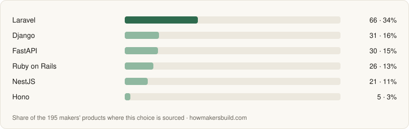</picture></a>

All 10 with what each is best for, comparisons and pricing

| Tool | Used by | Best for | More |
|---|---|---|---|
| [Laravel](https://howmakersbuild.com/tools/laravel) · open source | 64 (33%) | PHP apps with ORM, queues, auth scaffolding and an optional paid ecosystem for hosting and admin panels. | [vs AdonisJS](https://howmakersbuild.com/compare/adonisjs-vs-laravel) |
| [FastAPI](https://howmakersbuild.com/tools/fastapi) · open source | 30 (16%) | Python APIs with request validation and interactive docs generated from type hints. | [vs Flask](https://howmakersbuild.com/compare/fastapi-vs-flask) |
| [Django](https://howmakersbuild.com/tools/django) · open source | 30 (16%) | Python apps that want an ORM, migrations, auth and an admin panel on day one. | [vs Flask](https://howmakersbuild.com/compare/django-vs-flask) |
| [Ruby on Rails](https://howmakersbuild.com/tools/rails) · open source | 26 (14%) | Full-stack Ruby apps where one developer builds models, views, jobs and emails with strong conventions. | [vs Laravel](https://howmakersbuild.com/compare/laravel-vs-rails) |
| [NestJS](https://howmakersbuild.com/tools/nestjs) · open source | 21 (11%) | Larger TypeScript backends organized into modules, with dependency injection and decorators. | [vs Hono](https://howmakersbuild.com/compare/hono-vs-nestjs) |
| [Hono](https://howmakersbuild.com/tools/hono) · open source | 5 (3%) | Small TypeScript APIs that run on Node, Bun, Deno or edge platforms like Cloudflare Workers. | [vs Express](https://howmakersbuild.com/compare/express-vs-hono) |
| [Wasp](https://howmakersbuild.com/tools/wasp) · open source | 5 (3%) | Full-stack React and Node.js apps where a config file declares auth, routes, jobs and emails and Wasp generates the wiring. |  |
| [Flask](https://howmakersbuild.com/tools/flask) · open source | 4 (2%) | Small Python web apps and APIs where you add only the extensions you need. | [vs Django](https://howmakersbuild.com/compare/django-vs-flask) |
| [Express](https://howmakersbuild.com/tools/express) · open source | 3 (2%) | Node.js servers where you want a widely documented default and a huge middleware catalog. | [vs Hono](https://howmakersbuild.com/compare/express-vs-hono) |
| [AdonisJS](https://howmakersbuild.com/tools/adonisjs) · open source | 3 (2%) | TypeScript apps that want Rails- or Laravel-style conventions — ORM, migrations, auth, validation and mail — in Node.js. | [vs Laravel](https://howmakersbuild.com/compare/adonisjs-vs-laravel) |

### Database Access & ORMs

How your code reads and writes the database — typed queries, schema changes and migrations — once you've picked where the data lives. What 50 makers' products chose — [decide by situation](https://howmakersbuild.com/tasks/orm).

<a href="https://howmakersbuild.com/tasks/orm"><picture><source media="(prefers-color-scheme: dark)" srcset="charts/orm-dark.svg">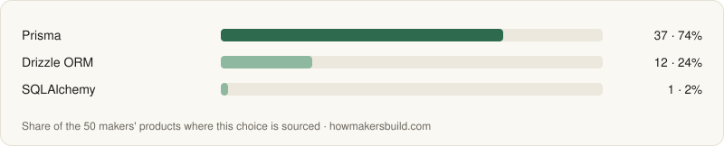</picture></a>

All 3 with what each is best for, comparisons and pricing

| Tool | Used by | Best for | More |
|---|---|---|---|
| [Prisma](https://howmakersbuild.com/tools/prisma) · open source | 37 (74%) | A schema-first ORM with generated types and migrations. | [vs Drizzle ORM](https://howmakersbuild.com/compare/drizzle-vs-prisma) |
| [Drizzle ORM](https://howmakersbuild.com/tools/drizzle) · open source | 12 (24%) | A thin, SQL-like TypeScript ORM that runs well on serverless and edge runtimes. | [vs Prisma](https://howmakersbuild.com/compare/drizzle-vs-prisma) |
| [SQLAlchemy](https://howmakersbuild.com/tools/sqlalchemy) · open source | 1 (2%) | Python backends (FastAPI, Flask, scripts) that want an ORM or a SQL toolkit over any relational database. |  |

### File Storage

Store the files your users upload — avatars, attachments, exports — and serve them back without filling up your app server. What 10 makers' products chose — [decide by situation](https://howmakersbuild.com/tasks/file-storage).

<a href="https://howmakersbuild.com/tasks/file-storage"><picture><source media="(prefers-color-scheme: dark)" srcset="charts/file-storage-dark.svg">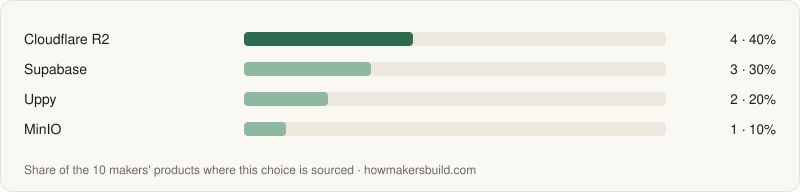</picture></a>

All 4 with what each is best for, comparisons and pricing

| Tool | Used by | Best for | More |
|---|---|---|---|
| [Cloudflare R2](https://howmakersbuild.com/tools/cloudflare-r2) | 4 (40%) | Files that get downloaded often — the S3 API without egress fees. | [vs Supabase](https://howmakersbuild.com/compare/cloudflare-r2-vs-supabase) · [pricing](https://howmakersbuild.com/tools/cloudflare-r2/pricing) |
| [Supabase](https://howmakersbuild.com/tools/supabase) · open source | 3 (30%) | Apps already on Supabase — storage access follows the same row-level security policies as your data. | [vs Cloudflare R2](https://howmakersbuild.com/compare/cloudflare-r2-vs-supabase) · [pricing](https://howmakersbuild.com/tools/supabase/pricing) |
| [Uppy](https://howmakersbuild.com/tools/uppy) · open source | 2 (20%) | An open-source upload widget with drag-and-drop, progress, resumable uploads and direct-to-S3, in front of whatever bucket you choose. |  |
| [MinIO](https://howmakersbuild.com/tools/minio) · open source | 1 (10%) | The long-standing S3-compatible server for self-hosting, with many existing guides, Docker setups and client SDKs. |  |

### Background Jobs & Cron

Run work outside the request — sending batches, processing uploads, calling slow AI APIs, nightly cleanups — with retries when it fails. What 81 makers' products chose — [decide by situation](https://howmakersbuild.com/tasks/background-jobs).

<a href="https://howmakersbuild.com/tasks/background-jobs"><picture><source media="(prefers-color-scheme: dark)" srcset="charts/background-jobs-dark.svg"></picture></a>

All 9 with what each is best for, comparisons and pricing

| Tool | Used by | Best for | More |
|---|---|---|---|
| [Temporal](https://howmakersbuild.com/tools/temporal) · open source | 35 (43%) | Long-running, multi-step workflows — payments, onboarding, AI agent loops — whose state must survive crashes and deploys, in Go, Java, Python, TypeScript and more. | [vs Inngest](https://howmakersbuild.com/compare/inngest-vs-temporal) · [pricing](https://howmakersbuild.com/tools/temporal/pricing) |
| [Trigger.dev](https://howmakersbuild.com/tools/trigger-dev) · open source | 23 (28%) | Long-running TypeScript tasks — AI calls, media processing — that would time out in a serverless function. | [vs Inngest](https://howmakersbuild.com/compare/inngest-vs-trigger-dev) · [pricing](https://howmakersbuild.com/tools/trigger-dev/pricing) |
| [Inngest](https://howmakersbuild.com/tools/inngest) · open source | 16 (20%) | Event-driven, multi-step workflows where each step retries on its own and your code stays in your existing app. | [vs Temporal](https://howmakersbuild.com/compare/inngest-vs-temporal) · [pricing](https://howmakersbuild.com/tools/inngest/pricing) |
| [RabbitMQ](https://howmakersbuild.com/tools/rabbitmq) · open source | 3 (4%) | A dedicated message broker for queues and pub/sub between services, in any language, or as the broker behind Celery. |  |
| [Dagster](https://howmakersbuild.com/tools/dagster) · open source | 3 (4%) | Data pipelines described by the tables, files and models they produce, with lineage between them, schedules, sensors and native dbt integration, in Python. |  |
| [Upstash](https://howmakersbuild.com/tools/upstash) | 2 (2%) | Simple scheduled calls and delayed HTTP jobs on serverless or edge hosting, via QStash. | [pricing](https://howmakersbuild.com/tools/upstash/pricing) |
| [BullMQ](https://howmakersbuild.com/tools/bullmq) · open source | 1 (1%) | Node apps on a long-running server that already have Redis — free and fully in your control. |  |
| [Apache Airflow](https://howmakersbuild.com/tools/apache-airflow) · open source | 1 (1%) | Scheduled batch pipelines — loading data, rebuilding reports, retraining models — written as Python DAGs, with managed versions such as Astro, Google Cloud Composer and Amazon MWAA if you don't want to run it. |  |
| [Prefect](https://howmakersbuild.com/tools/prefect) · open source | 1 (1%) | Turning existing Python scripts into scheduled, retried, monitored workflows with decorators, using ordinary Python control flow instead of a fixed DAG. |  |

### Transactional Email

Send the emails your app triggers — sign-up confirmations, password resets, receipts — and make sure they arrive. What 2,460 makers' products chose — [decide by situation](https://howmakersbuild.com/tasks/transactional-email).

<a href="https://howmakersbuild.com/tasks/transactional-email"><picture><source media="(prefers-color-scheme: dark)" srcset="charts/transactional-email-dark.svg">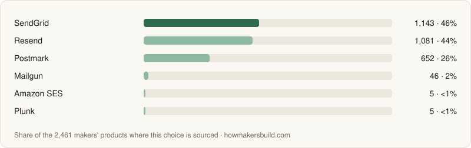</picture></a>

All 7 with what each is best for, comparisons and pricing

| Tool | Used by | Best for | More |
|---|---|---|---|
| [SendGrid](https://howmakersbuild.com/tools/sendgrid) | 1,142 (46%) | One vendor for both jobs at large scale. | [vs Amazon SES](https://howmakersbuild.com/compare/amazon-ses-vs-sendgrid) · [pricing](https://howmakersbuild.com/tools/sendgrid/pricing) |
| [Resend](https://howmakersbuild.com/tools/resend) | 1,081 (44%) | A modern developer API with email templates written as React components. | [vs Postmark](https://howmakersbuild.com/compare/postmark-vs-resend) · [pricing](https://howmakersbuild.com/tools/resend/pricing) |
| [Postmark](https://howmakersbuild.com/tools/postmark) | 652 (27%) | Deliverability when the mail has to arrive within seconds. | [vs Resend](https://howmakersbuild.com/compare/postmark-vs-resend) · [pricing](https://howmakersbuild.com/tools/postmark/pricing) |
| [Mailgun](https://howmakersbuild.com/tools/mailgun) | 46 (2%) | High volume and inbound email parsing and routing. | [vs SendGrid](https://howmakersbuild.com/compare/mailgun-vs-sendgrid) · [pricing](https://howmakersbuild.com/tools/mailgun/pricing) |
| [Amazon SES](https://howmakersbuild.com/tools/amazon-ses) | 5 (<1%) | Sending at high volume, where cost per email matters more than tooling. | [vs SendGrid](https://howmakersbuild.com/compare/amazon-ses-vs-sendgrid) · [pricing](https://howmakersbuild.com/tools/amazon-ses/pricing) |
| [Plunk](https://howmakersbuild.com/tools/plunk) · open source | 5 (<1%) | Transactional emails, event-triggered sequences and newsletters in one open-source tool, billed per email with no monthly fee. |  |
| [Loops](https://howmakersbuild.com/tools/loops) | 1 (<1%) | SaaS onboarding sequences triggered by product events, with transactional sending included. | [pricing](https://howmakersbuild.com/tools/loops/pricing) |

### Payments

Charge customers — one-off or subscription — and stay on the right side of sales tax. What 1,198 makers' products chose — [decide by situation](https://howmakersbuild.com/tasks/payments).

<a href="https://howmakersbuild.com/tasks/payments"><picture><source media="(prefers-color-scheme: dark)" srcset="charts/payments-dark.svg">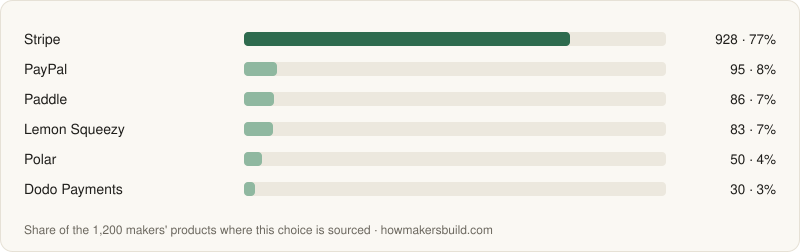</picture></a>

All 7 with what each is best for, comparisons and pricing

| Tool | Used by | Best for | More |
|---|---|---|---|
| [Stripe](https://howmakersbuild.com/tools/stripe) | 927 (77%) | Full control over checkout and billing, lower fees than a merchant of record, and the widest integration ecosystem. | [vs Lemon Squeezy](https://howmakersbuild.com/compare/lemon-squeezy-vs-stripe) · [pricing](https://howmakersbuild.com/tools/stripe/pricing) |
| [PayPal](https://howmakersbuild.com/tools/paypal) | 94 (8%) | Adding PayPal and Venmo as a checkout option for buyers who won't type in a card. | [vs Stripe](https://howmakersbuild.com/compare/paypal-vs-stripe) · [pricing](https://howmakersbuild.com/tools/paypal/pricing) |
| [Paddle](https://howmakersbuild.com/tools/paddle) | 86 (7%) | Established SaaS businesses that want a mature MoR. | [vs Lemon Squeezy](https://howmakersbuild.com/compare/lemon-squeezy-vs-paddle) · [pricing](https://howmakersbuild.com/tools/paddle/pricing) |
| [Lemon Squeezy](https://howmakersbuild.com/tools/lemon-squeezy) | 83 (7%) | Selling software and digital downloads with minimal setup. | [vs Stripe](https://howmakersbuild.com/compare/lemon-squeezy-vs-stripe) · [pricing](https://howmakersbuild.com/tools/lemon-squeezy/pricing) |
| [Polar](https://howmakersbuild.com/tools/polar) · open source | 50 (4%) | Developers selling SaaS, subscriptions, usage-based plans or license keys. | [vs Dodo Payments](https://howmakersbuild.com/compare/dodo-payments-vs-polar) · [pricing](https://howmakersbuild.com/tools/polar/pricing) |
| [Dodo Payments](https://howmakersbuild.com/tools/dodo-payments) | 30 (3%) | AI and SaaS products with usage-based billing, selling globally. | [vs Stripe](https://howmakersbuild.com/compare/dodo-payments-vs-stripe) · [pricing](https://howmakersbuild.com/tools/dodo-payments/pricing) |
| [Razorpay](https://howmakersbuild.com/tools/razorpay) | 21 (2%) | Selling to customers in India, with UPI, cards, net banking and wallets in one checkout. |  |

### Usage-Based Billing

Charge customers for what they use — API calls, AI tokens, seats, storage — by metering events and turning them into invoices. What 11 makers' products chose — [decide by situation](https://howmakersbuild.com/tasks/usage-billing).

<a href="https://howmakersbuild.com/tasks/usage-billing"><picture><source media="(prefers-color-scheme: dark)" srcset="charts/usage-billing-dark.svg">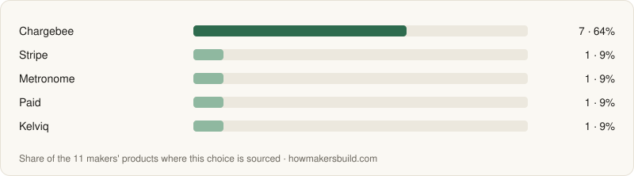</picture></a>

All 5 with what each is best for, comparisons and pricing

| Tool | Used by | Best for | More |
|---|---|---|---|
| [Chargebee](https://howmakersbuild.com/tools/chargebee) | 7 (64%) | A mature hosted billing system for subscriptions plus usage charges, invoices and dunning, on top of the payment gateway you already use. |  |
| [Stripe](https://howmakersbuild.com/tools/stripe) | 1 (9%) | Apps already on Stripe that want meters and usage-based prices next to their subscriptions. | [pricing](https://howmakersbuild.com/tools/stripe/pricing) |
| [Metronome](https://howmakersbuild.com/tools/metronome) | 1 (9%) | High-volume usage billing with SQL-defined metrics, rate cards, commits and credits, for self-serve and enterprise contracts. |  |
| [Paid](https://howmakersbuild.com/tools/paid) | 1 (9%) | Billing for AI agents by the work they do — agent events turned into value-based units, invoices that link each line to its events. |  |
| [Kelviq](https://howmakersbuild.com/tools/kelviq) | 1 (9%) | A merchant of record that also meters tokens, compute and API calls, with entitlements and global sales tax in one platform. |  |

### Error Monitoring

Find out when your app throws an error in production, with the stack trace and context to fix it, before users email you. What 190 makers' products chose — [decide by situation](https://howmakersbuild.com/tasks/error-monitoring).

<a href="https://howmakersbuild.com/tasks/error-monitoring"><picture><source media="(prefers-color-scheme: dark)" srcset="charts/error-monitoring-dark.svg">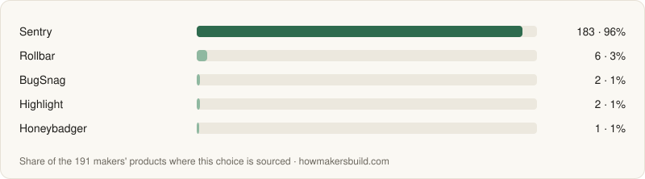</picture></a>

All 5 with what each is best for, comparisons and pricing

| Tool | Used by | Best for | More |
|---|---|---|---|
| [Sentry](https://howmakersbuild.com/tools/sentry) | 182 (96%) | Broad SDK coverage across languages and frameworks, with performance tracing next to errors. | [vs GlitchTip](https://howmakersbuild.com/compare/glitchtip-vs-sentry) · [pricing](https://howmakersbuild.com/tools/sentry/pricing) |
| [Rollbar](https://howmakersbuild.com/tools/rollbar) | 6 (3%) | Error grouping tied to releases, with session replays linked to errors. | [vs Sentry](https://howmakersbuild.com/compare/rollbar-vs-sentry) · [pricing](https://howmakersbuild.com/tools/rollbar/pricing) |
| [BugSnag](https://howmakersbuild.com/tools/bugsnag) | 2 (1%) | Crash and error reporting for mobile, web and backend apps, with a stability score for each release. |  |
| [Highlight](https://howmakersbuild.com/tools/highlight) · open source | 2 (1%) | Self-hosting errors, session replays, logs and traces from the open-source code of a product that no longer runs as a hosted service. |  |
| [Honeybadger](https://howmakersbuild.com/tools/honeybadger) | 1 (1%) | One tool covering errors, logs, uptime checks and cron monitoring, with a free plan for a single developer. | [pricing](https://howmakersbuild.com/tools/honeybadger/pricing) |

### Image & Video Hosting

Store user uploads and product media, resize and compress them on the fly, and serve them fast from a CDN. What 113 makers' products chose — [decide by situation](https://howmakersbuild.com/tasks/media-hosting).

<a href="https://howmakersbuild.com/tasks/media-hosting"><picture><source media="(prefers-color-scheme: dark)" srcset="charts/media-hosting-dark.svg">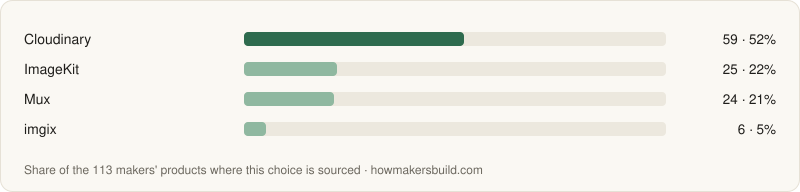</picture></a>

All 4 with what each is best for, comparisons and pricing

| Tool | Used by | Best for | More |
|---|---|---|---|
| [Cloudinary](https://howmakersbuild.com/tools/cloudinary) | 59 (52%) | Apps with lots of user-uploaded images and video that need crops, overlays and format conversion through URLs. | [pricing](https://howmakersbuild.com/tools/cloudinary/pricing) |
| [ImageKit](https://howmakersbuild.com/tools/imagekit) | 25 (22%) | Adding resizing and optimization in front of storage you already have, such as an S3 bucket. | [pricing](https://howmakersbuild.com/tools/imagekit/pricing) |
| [Mux](https://howmakersbuild.com/tools/mux) | 24 (21%) | Apps where video is the product — uploads encoded and streamed adaptively with a player and playback analytics. |  |
| [imgix](https://howmakersbuild.com/tools/imgix) | 6 (5%) | Resizing and optimizing images straight from your own bucket through URL parameters. | [pricing](https://howmakersbuild.com/tools/imgix/pricing) |

### Mobile Framework

Pick how you'll build your iOS and Android app — one shared codebase, fully native, or your existing web app wrapped as a native app. What 210 makers' products chose — [decide by situation](https://howmakersbuild.com/tasks/mobile-framework).

<a href="https://howmakersbuild.com/tasks/mobile-framework"><picture><source media="(prefers-color-scheme: dark)" srcset="charts/mobile-framework-dark.svg">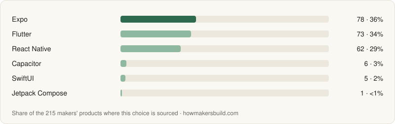</picture></a>

All 6 with what each is best for, comparisons and pricing

| Tool | Used by | Best for | More |
|---|---|---|---|
| [Expo](https://howmakersbuild.com/tools/expo) · open source | 75 (36%) | React Native apps for iOS and Android, with cloud builds, store submission and over-the-air updates. |  |
| [Flutter](https://howmakersbuild.com/tools/flutter) · open source | 71 (34%) | Pixel-consistent UI across iOS, Android, web and desktop from one Dart codebase. |  |
| [React Native](https://howmakersbuild.com/tools/react-native) · open source | 62 (30%) | iOS and Android apps written in React that render real native views, with full control over the native projects and build setup. |  |
| [Capacitor](https://howmakersbuild.com/tools/capacitor) · open source | 6 (3%) | Shipping your existing web app to the app stores with access to native APIs through plugins. |  |
| [SwiftUI](https://howmakersbuild.com/tools/swiftui) | 5 (2%) | Apple-only apps that should feel fully native and use new platform features on day one. |  |
| [Jetpack Compose](https://howmakersbuild.com/tools/jetpack-compose) · open source | 1 (<1%) | Android-only apps that should feel fully native, with Google's recommended UI toolkit and immediate access to new Android APIs. |  |

### In-App Purchases & Subscriptions

Sell subscriptions and one-time purchases inside iOS and Android apps, and know who has paid, without writing receipt validation for each store. What 121 makers' products chose — [decide by situation](https://howmakersbuild.com/tasks/in-app-purchases).

<a href="https://howmakersbuild.com/tasks/in-app-purchases"><picture><source media="(prefers-color-scheme: dark)" srcset="charts/in-app-purchases-dark.svg">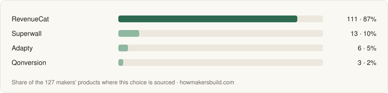</picture></a>

All 4 with what each is best for, comparisons and pricing

| Tool | Used by | Best for | More |
|---|---|---|---|
| [RevenueCat](https://howmakersbuild.com/tools/revenuecat) | 105 (87%) | A widely used cross-platform SDK for purchases, entitlements and subscription analytics, free until meaningful revenue. |  |
| [Superwall](https://howmakersbuild.com/tools/superwall) | 13 (11%) | Apps that want to iterate on paywall design, pricing and placement remotely and A/B test them. |  |
| [Adapty](https://howmakersbuild.com/tools/adapty) | 6 (5%) | A subscription backend with a built-in paywall builder and A/B tests, when you want both in one tool. |  |
| [Qonversion](https://howmakersbuild.com/tools/qonversion) | 3 (2%) | A subscription backend with entitlements, analytics and paywall experiments, at a lower revenue share past its free threshold. |  |

## Grow

Knowing who uses the product and bringing more people to it — analytics, email, and showing up in AI search answers.

### Web Analytics

Count how many people visit your site, which pages they read, and where they came from — search, social posts, launch sites or newsletters. What 900 makers' products chose — [decide by situation](https://howmakersbuild.com/tasks/web-analytics).

<a href="https://howmakersbuild.com/tasks/web-analytics"><picture><source media="(prefers-color-scheme: dark)" srcset="charts/web-analytics-dark.svg">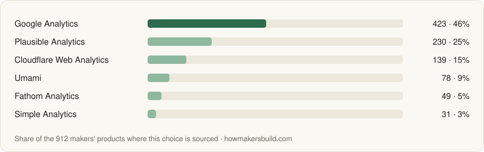</picture></a>

All 6 with what each is best for, comparisons and pricing

| Tool | Used by | Best for | More |
|---|---|---|---|
| [Google Analytics](https://howmakersbuild.com/tools/google-analytics) | 412 (46%) | Free, deep campaign and audience reporting tied to Google Ads and Search Console. | [pricing](https://howmakersbuild.com/tools/google-analytics/pricing) |
| [Plausible Analytics](https://howmakersbuild.com/tools/plausible) · open source | 230 (26%) | One page of traffic numbers with no cookie banner, with funnels and revenue goals on higher plans. | [pricing](https://howmakersbuild.com/tools/plausible/pricing) |
| [Cloudflare Web Analytics](https://howmakersbuild.com/tools/cloudflare-web-analytics) | 139 (15%) | Free cookie-free visit counts for sites on any host, set up in minutes. | [pricing](https://howmakersbuild.com/tools/cloudflare-web-analytics/pricing) |
| [Umami](https://howmakersbuild.com/tools/umami) · open source | 78 (9%) | Open-source website analytics you can self-host free, with a cloud free plan up to 100,000 events a month. | [pricing](https://howmakersbuild.com/tools/umami/pricing) |
| [Fathom Analytics](https://howmakersbuild.com/tools/fathom) | 48 (5%) | A cookie-free dashboard with up to 50 sites on every plan. | [pricing](https://howmakersbuild.com/tools/fathom/pricing) |
| [Simple Analytics](https://howmakersbuild.com/tools/simple-analytics) | 31 (3%) | A free cookie-free plan with unlimited pageviews, keeping only the last 30 days of data. | [pricing](https://howmakersbuild.com/tools/simple-analytics/pricing) |

### Product Analytics

See what signed-in users do inside the product — which steps they finish, where they drop off, and whether they come back. What 521 makers' products chose — [decide by situation](https://howmakersbuild.com/tasks/product-analytics).

<a href="https://howmakersbuild.com/tasks/product-analytics"><picture><source media="(prefers-color-scheme: dark)" srcset="charts/product-analytics-dark.svg">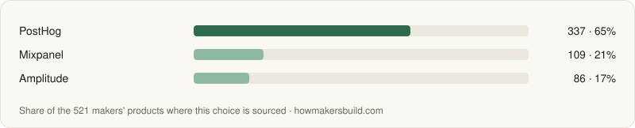</picture></a>

All 3 with what each is best for, comparisons and pricing

| Tool | Used by | Best for | More |
|---|---|---|---|
| [PostHog](https://howmakersbuild.com/tools/posthog) · open source | 337 (65%) | One tool for analytics, session replay, feature flags, experiments and surveys, each with its own free monthly allowance. | [vs Amplitude](https://howmakersbuild.com/compare/amplitude-vs-posthog) · [pricing](https://howmakersbuild.com/tools/posthog/pricing) |
| [Mixpanel](https://howmakersbuild.com/tools/mixpanel) | 109 (21%) | Mature funnel, retention and cohort analysis on event data. | [vs PostHog](https://howmakersbuild.com/compare/mixpanel-vs-posthog) · [pricing](https://howmakersbuild.com/tools/mixpanel/pricing) |
| [Amplitude](https://howmakersbuild.com/tools/amplitude) | 86 (17%) | Funnel, retention and cohort analysis, with session replay and experiments on every plan, including free. | [vs PostHog](https://howmakersbuild.com/compare/amplitude-vs-posthog) · [pricing](https://howmakersbuild.com/tools/amplitude/pricing) |

### Newsletter

Build an email list you own and send regular updates, so your audience doesn't depend on any algorithm. What 157 makers' products chose — [decide by situation](https://howmakersbuild.com/tasks/newsletter).

<a href="https://howmakersbuild.com/tasks/newsletter"><picture><source media="(prefers-color-scheme: dark)" srcset="charts/newsletter-dark.svg">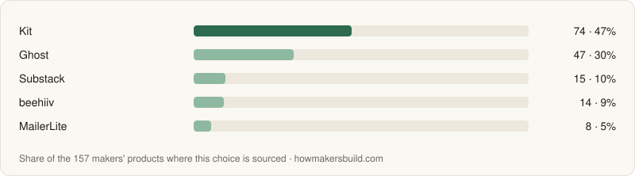</picture></a>

All 5 with what each is best for, comparisons and pricing

| Tool | Used by | Best for | More |
|---|---|---|---|
| [Kit](https://howmakersbuild.com/tools/kit) | 74 (47%) | Creators who need automations and tagged sequences, like a course launch funnel. | [pricing](https://howmakersbuild.com/tools/kit/pricing) |
| [Ghost](https://howmakersbuild.com/tools/ghost) · open source | 47 (30%) | A publication with its own site, memberships and paid subscriptions, open source or hosted. | [pricing](https://howmakersbuild.com/tools/ghost/pricing) |
| [Substack](https://howmakersbuild.com/tools/substack) | 15 (10%) | Writers who want discovery from Substack's own reader network and free sending. | [pricing](https://howmakersbuild.com/tools/substack/pricing) |
| [beehiiv](https://howmakersbuild.com/tools/beehiiv) | 14 (9%) | A newsletter you want to grow and monetize, with referrals, a recommendation network and ads. | [pricing](https://howmakersbuild.com/tools/beehiiv/pricing) |
| [MailerLite](https://howmakersbuild.com/tools/mailerlite) | 8 (5%) | Newsletters with signup forms, automations and landing pages, on a free plan that grows by subscriber count. | [pricing](https://howmakersbuild.com/tools/mailerlite/pricing) |

### Lifecycle Email

Send the right email at the right point in a user's journey — onboarding, nudges, upgrade prompts, win-backs — based on what they did in your product. What 287 makers' products chose — [decide by situation](https://howmakersbuild.com/tasks/lifecycle-email).

<a href="https://howmakersbuild.com/tasks/lifecycle-email"><picture><source media="(prefers-color-scheme: dark)" srcset="charts/lifecycle-email-dark.svg">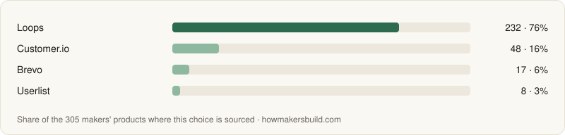</picture></a>

All 3 with what each is best for, comparisons and pricing

| Tool | Used by | Best for | More |
|---|---|---|---|
| [Loops](https://howmakersbuild.com/tools/loops) | 231 (80%) | Event-triggered onboarding sequences and transactional email from one tool, with a free tier to start. | [pricing](https://howmakersbuild.com/tools/loops/pricing) |
| [Customer.io](https://howmakersbuild.com/tools/customer-io) | 48 (17%) | Complex behavior-driven journeys across email, push, SMS and in-app messages. | [pricing](https://howmakersbuild.com/tools/customer-io/pricing) |
| [Userlist](https://howmakersbuild.com/tools/userlist) | 8 (3%) | B2B SaaS where messages depend on both the user and the company account they belong to. | [pricing](https://howmakersbuild.com/tools/userlist/pricing) |

### AI Search Visibility (GEO)

See whether ChatGPT, Perplexity, Gemini and Google's AI answers mention and cite your product when people ask about your category, and what to change so they do. What 1 makers' products chose — [decide by situation](https://howmakersbuild.com/tasks/geo).

<a href="https://howmakersbuild.com/tasks/geo"><picture><source media="(prefers-color-scheme: dark)" srcset="charts/geo-dark.svg"></picture></a>

All 1 with what each is best for, comparisons and pricing

| Tool | Used by | Best for | More |
|---|---|---|---|
| [AthenaHQ](https://howmakersbuild.com/tools/athenahq) | 1 (100%) | Tracking across 11 AI models with citation-source analysis, content recommendations and an agent that drafts changes. |  |

## How the counts work

- **Used by** counts makers' products — indie launches to small teams — where a source ties the tool to that decision. The percentage is a share of the products where we could source the decision at all, so each table has its own sample.
- Open-source repositories known only from their dependencies aren't counted here: most aren't products. They're listed separately on each tool's page.
- What a website can show is over-counted, and what runs behind it is under-counted: a hosted auth widget is easy to spot, an auth library isn't. A tool missing from a table isn't unused, just unobserved.
- More on each kind of evidence: [how evidence is collected](https://howmakersbuild.com/about/evidence).

## Contributing

Know a product built with one of these tools? [Open an issue](../../issues/new) with the product, the tool and a public source that says so — the maker's own post, a page on its site, a job posting. It's checked and added to the data, and shows up here on the next weekly refresh.

The README is generated, so pull requests that edit it by hand get overwritten; issues are the way in.

## License

[CC BY 4.0](https://creativecommons.org/licenses/by/4.0/): use it anywhere, with a link back to [How Makers Build](https://howmakersbuild.com).
